# Bio7 User Guide Version 4.0 (work in progress)


*© 2005-2026 M. Austenfeld · Updated: 06.11.2026*

The application Bio7 is an integrated development environment for ecological modelling and contains powerful tools for model creation, scientific image analysis and statistical analysis. The application itself is based on an RCP-Eclipse-Environment (Rich-Client-Platform) which offers a huge flexibility in configuration and extensibility because of its plug-in structure and the possibility of customization. Over the past years Bio7 evolved to a general simulation and analysis platform also useful for a variety of other scientific disciplines. In this platform powerful known tools were integrated for the purpose of simulations and analysis. The complexity of a modelling process is hidden behind a user-friendly flexible Graphical User Interface which should assist the development and analysis of simulation models. Therefore Bio7 offers and embeds also powerful and well proofed third party tools which are capable to do Image Analysis (ImageJ), Statistical Analysis (R), easy to learn scripting languages to ease the development of simulation models and an embedded compiler for the need of speed in complex calculations. Additionally editors (Java, R, BeanShell/Groovy, Jython) and different panels for visualization are integrated for an easier development. Communication in between the different components is possible by means of scripts and compiled code and can be collected in a executeable flowchart for “Sensitivity Analysis”, etc. Furthermore an advantage of this platform is the plugin structure which can be extended with all kind of third party plugins to support theoretical hypothesis on ecosystems functioning and the understanding of complex systems.


## Contents

- [1 Why Bio7?](README.md#1-why-bio7)
   - [1.1 Ecological Background](README.md#11-ecological-background)
- [2 Getting started](README.md#2-getting-started)
   - [2.1 Installation](README.md#21-installation)
- [3 The Platform-Architecture](README.md#3-the-platform-architecture)
   - [3.1 The Toolbar](README.md#31-the-toolbar)
   - [3.2 The Menu](README.md#32-the-menu)
- [4 The Perspectives of Bio7](README.md#4-the-perspectives-of-bio7)
   - [4.1 Resource Perspective](README.md#41-resource-perspective)
   - [4.2 ImageJ Edit Perspective](README.md#42-imagej-edit-perspective)
   - [4.3 R ImageJ Analysis Perspective](README.md#43-r-imagej-analysis-perspective)
   - [4.4 The 3d Perspective](README.md#44-the-3d-perspective)
   - [4.5 The WorldWind Perspective](README.md#45-the-worldwind-perspective)
   - [4.6 The R Perspective and Menus](README.md#46-the-r-perspective-and-menus)
   - [4.7 Document Perspective](README.md#47-document-perspective)
   - [4.8 The HTML (Web) Perspective](README.md#48-the-html-web-perspective)
   - [4.9 Custom Perspective, Views and Menus](README.md#49-custom-perspective-views-and-menus)
- [5 The Editors of Bio7](README.md#5-the-editors-of-bio7)
   - [5.1 General Features](README.md#51-general-features)
- [6 Preferences](README.md#6-preferences)
   - [6.1 The Bio7 Preferences](README.md#61-the-bio7-preferences)
- [7 Help](README.md#7-help)
- [8 Update Manager](README.md#8-update-manager)
- [9 Additional Views and Interfaces](README.md#9-additional-views-and-interfaces)
   - [9.1 Additional Eclipse views in Bio7](README.md#91-additional-eclipse-views-in-bio7)
   - [9.2 Java and Script Interaction with R](README.md#92-java-and-script-interaction-with-r)
   - [9.3 LibreOffice features of Bio7](README.md#93-libreoffice-features-of-bio7)
- [10 What else ?](README.md#10-what-else-)
   - [10.1 Native Preferences](README.md#101-native-preferences)
   - [10.2 Drag, Drop, Compile and Start](README.md#102-drag-drop-compile-and-start)
   - [10.3 Drag and Drop Files](README.md#103-drag-and-drop-files)
   - [10.4 Install Eclipse, R, ImageJ Plugins or Packages in Bio7](README.md#104-install-eclipse-r-imagej-plugins-or-packages-in-bio7)
   - [10.5 Bio7 Themes](README.md#105-bio7-themes)
   - [10.6 Install Git](README.md#106-install-git)
   - [10.7 Bio7 Browser](README.md#107-bio7-browser)
   - [10.8 Uninstall Eclipse Plugins](README.md#108-uninstall-eclipse-plugins)
   - [10.9 Programming Examples for Bio7](README.md#109-programming-examples-for-bio7)
- [11 Literature and Links](README.md#11-literature-and-links)
   - [11.1 Scientific Libraries Available in Bio7](README.md#111-scientific-libraries-available-in-bio7)
   - [11.2 Documentation and Programming Links:](README.md#112-documentation-and-programming-links)
- [12 Addendum](README.md#12-addendum)
- [13 Definition of Expressions](README.md#13-definition-of-expressions)

---

# 1 Why Bio7?

## 1.1 Ecological Background

The application Bio7 was originally developed for the chair of experimental and systems biology (Bio7) to create and analyze spatially explizit simulation models on dry acidic grasslands on inland sand dunes. Only specialists like Corynephorus canescens, Polytrichum piliferum, etc. can settle on this nutrient poor water limited sandy soils. Additionally high temperatures on the surface of the soil and erosion make it very hard for other species to settle there. In comparison to other ecosystems this habitat is less complex in its species structure and nutrient dynamics which facilitates monitoring of vegetation dynamics to identify the driving forces or key factors of the system. With the exploration of this ecosystem several questions and hypothesis should be answered and verified. Because many specialized plants and animals occur in this habitat the main question is, how we can protect and preserve this valuable ecosystem at all. Also the key factors are from high interest and can maybe serve to identify similar processes in more complex systems like the tropical rainforest. From various experiments in these systems we have knowledge about seed dispersal, competition, and nutrients availability or dependencies from different species which are typical for this habitat. We use the capabilities of this application to express the features of this system in syntactical rules for simulation.

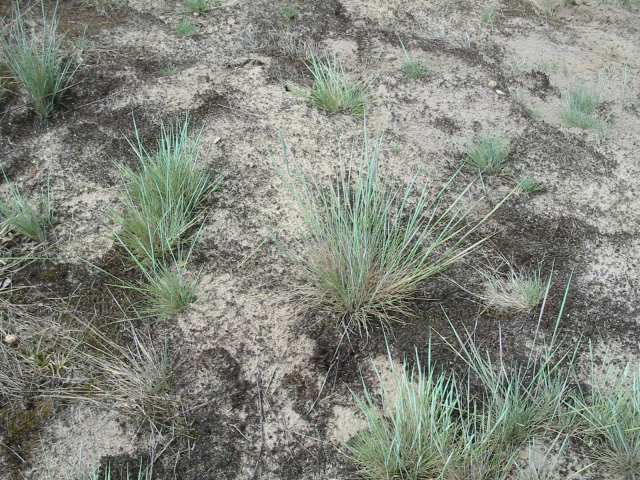

*Figure 1.1 Dry Acidic Grasslands*

[↑ Contents](#contents)

---

# 2 Getting started

## 2.1 Installation

### 2.1.1 System requirements:

It is recommended that your computer should have at least 1024 mb ram and a 1 ghz processor. A 3d Graphics Card which is OpenGL enabled (only necessary for the “Spatial” view and the embedded “WorldWind” view. To use the LibreOffice feature of Bio7 an installation of LibreOffice &gt;= 4.0 is required. The path to LibreOffice will be automatically fetched by Bio7 from the registry (Windows) or can be adjusted in the Bio7 preferences (Windows, Linux, MacOSX) to the default path.

### 2.1.2 Installation:

#### 2.1.2.1 Windows

Just download the \*.zip distribution file from the Bio7 Github Releases (<https://github.com/Bio7/bio7/releases>) and unzip it in your preferred location (avoid spaces in path!). Bio7 comes bundled with Java Adoptium and works out of the box. R and Rserve is not bundled (since Bio7 3.6) anymore by default! Download and install R and adjust the R path in the Bio7 preferences (optional also the default R packages path): Preferences-&gt;Preferences Bio7-&gt;Preferences R

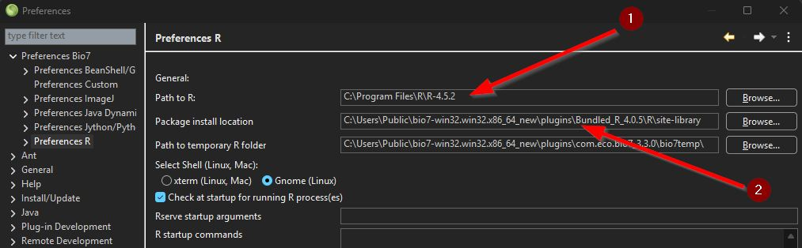

*Figure 2.1 (1) The path to R. (2) The Path where new R packages will be installed. Default paths on Windows are given and displayed which point to a local Bio7 installation.*

Install the Rserve package in R (no special Rserve version needed - see below Linux and MacOSX). For the Rserve installation you can also execute a Groovy script in the R-Shell-view after the R installation (start R in the Bio7 console).

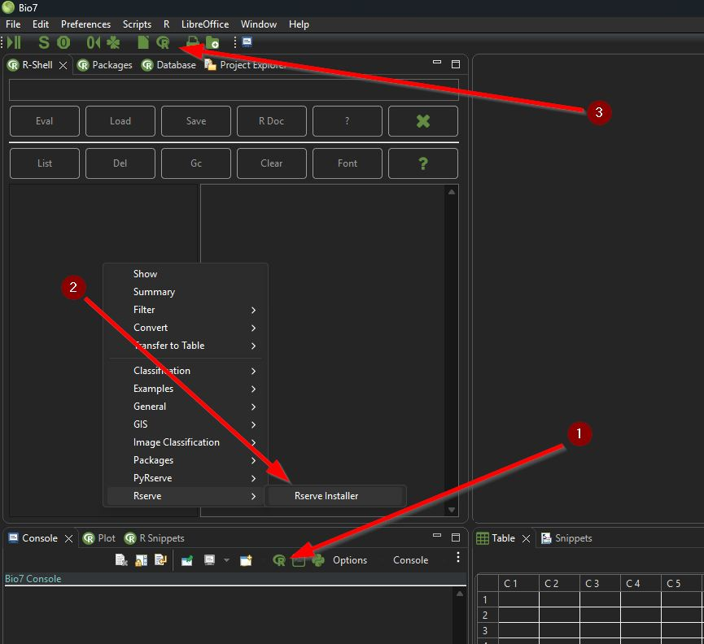

*Figure 2.2 (1) Start R in the Bio7 console. (2) Execute the Groovy Rserve ‘download and install’ script for all supported platforms. (3) Finally start Rserve within R.*

#### 2.1.2.2 Linux

Download and extract the installation file from Bio7 Github Releases. Bio7 comes bundled with Java (Adoptium). Please note that you have to start Bio7 with Xorg (X display server) because of SWT\_AWT which is used by ImageJ. For Linux you have to install R and a special compiled version of Rserve. The default OS path to R is used automatically if not set (like in Windows) in the preferences. Simply execute an available Groovy script in the R-Shell view (see Windows notes above).  
To install Rserve manually start the R console and paste the following command, see:  
<https://github.com/Bio7/Rserve-Cooperative>

#### 2.1.2.3 MacOSX

Download and extract the installation file from Bio7 Github Releases. Bio7 comes bundled with Java (Adoptium). For MacOSX you have to install R and a special compiled version of Rserve. The default OS path to R is used automatically if not set (like in Windows) in the preferences. Simply execute an available Groovy script in the R-Shell view (see Windows notes above). To install Rserve manually start the R console and paste the following command, see:  
<https://github.com/Bio7/Rserve-Cooperative>**  
  
To start Bio7 (unsigned) on MacOSX**:  
To start Bio7 after installation please follow this advice (sign app locally):  
<https://github.com/Bio7/bio7/discussions/30>

#### 2.1.2.4 Rserve local installation (compiled for cooperative mode on Linux and MacOSX, 64-bit platforms)

Manual local installation on Windows, MacOSX and Linux from R command line (please adapt the file path!):

Windows:

```
install.packages("C:/xxx/Rserve_1.8-8.zip", repos=NULL)
```

Figure 2.3 R command to build Rserve (from an archive)

MacOSX:

```
install.packages("/Users/xxx/Rserve_1.8-8.tgz", repos=NULL)
```

Figure 2.4 R command to build Rserve (from an archive)

Linux (Compiled with Ubuntu 20.10):

```
install.packages("/home/xxx/Rserve_1.8-8.tar.gz", repos=NULL)
```

Figure 2.5 R command to build Rserve (from an archive)

#### 2.1.2.5 Build of Rserve in cooperative mode on Linux or MacOSX (if necessary!)

Rserve can be build with cooperative mode enabled (from an archive or unpacked) with the shell command:

```
sudo PKG_CPPFLAGS=-DCOOPERATIVE R CMD INSTALL --build Rserve_1.8-8.tar.gz
```

Figure 2.6 R command to build Rserve (from an archive)

```
sudo PKG_CPPFLAGS=-DCOOPERATIVE R CMD INSTALL --build Rserve
```

Figure 2.7 R command to build Rserve (unpacked)

### 2.1.3 R Windows specific:

The default add-on package location in a Bio7 release is now: “Bio7\\plugins\\Bundled\_R\_x.xx.xx\\R\\site-library”. At this location inside of Bio7 the packages will be installed by default (if not changed!).

### 2.1.4 Useful R packages

To use all Bio7 functions ( for editor formating, knitr documents, markdown documents, spatial analysis and import, export of spatial data) some R packages are recommended and required to install.You can install all packages e.g. with a R script available in the R-Shell view context menu of Bio7 (Packages-&gt;Install\_Default\_R\_Packages)

#### 2.1.4.1 R packages Linux specific:

For Linux there are no binaries available. For the compilation of the R packages the Linux packages g++ and gfortran have to be installed (if not available by default!). For the compilation of the rgdal package in addition you need the Linux packages: gdal, libgdal-dev, libproj-dev. If you would like to install the spatstat package, too, you need: libblas-dev,liblapack

### 2.1.5 R Markdown

To use the R Markdown features please install the rmarkdown package, knitr from within R and the pandoc binaries from here: <https://github.com/jgm/pandoc/releases/latest>

For Windows and MacOSX pandoc must be on the system PATH – Linux adds the path by default! You can also add the path in R with:

MacOSX:

Add pandoc to the OS PATH. Else type in the R console:

```
Sys.setenv(PATH="/usr/bin:/bin:/usr/sbin:/sbin:/usr/local/bin")
```

Figure 2.8 R command to set OS PATH in R only

or with the LaTeX path added:

```
Sys.setenv(PATH="/usr/bin:/bin:/usr/sbin:/sbin:/usr/local/bin:/Library/TeX/texbin:$HOME/bin")
```

Figure 2.9 R command to set OS PATH in R only

Linux:

After installation typically available!!!! Else type in the R console:

```
Sys.setenv(PATH="/usr/bin:/bin:/usr/sbin:/sbin:/usr/local/bin:$HOME/bin")
```

Figure 2.10 R command to set OS PATH in R only

Windows:

Add pandoc path to the Windows PATH if necessary (evtl. restart). Else type in the R console:

```
Sys.setenv(PATH=paste(Sys.getenv("PATH"),"C:/pandoc”, sep=""))
```

Figure 2.11 R command to set OS PATH in R only

The commands can be copied and saved for each startup (**only if necessary!**) in the R preferences textfield (see figure below):

**Preferences-&gt;Preferences R-&gt;R startup commands**

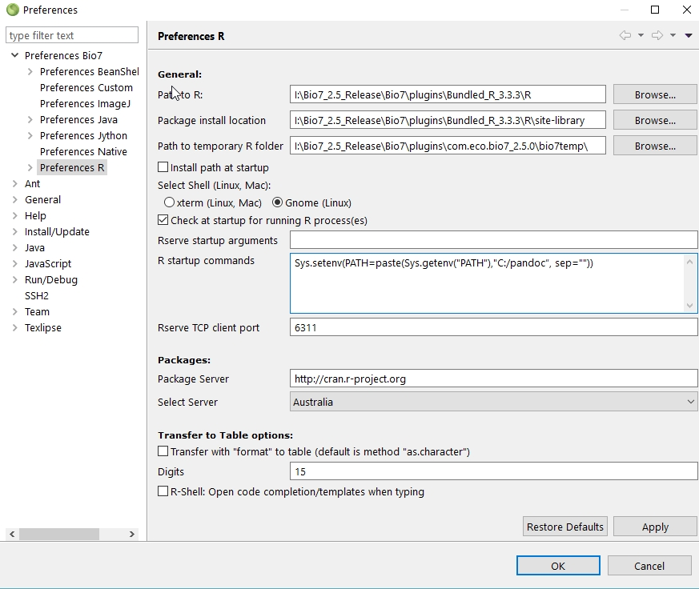

*Figure 2.12 The main R preferences with a startup command to set the path for pandoc in R*

### 2.1.6 LaTeX

To use LaTex with Bio7 please install a LaTeX environment e.g.:

Windows:

MiKTeX (<http://miktex.org/>)

MacOSX:

MacTeX (<https://tug.org/mactex/>)

Linux:

TeX Live (<http://www.tug.org/texlive/>)

Then adjust the Bio7 path to the pdflatex binary (only necessary if not on the OS path!):

**R-&gt;Preferences-&gt;Rserve preferences-&gt;pdflatex path**

To get the installation location folder on Linux or on MacOSX type:

**&gt; which pdflatex**

For Windows MikeTeX pdflatex can be typically found at:

**C:\\Program Files\\miktex\\bin**

#### 2.1.6.1 Linux

To compile markdown documents with pdflatex two packages seems to be required from texlive

```
sudo apt-get install texlive-latex-extra
sudo apt-get install lmodern
```

Figure 2.13 Linux command (apt) to install required pdflatex packages and styles

### 2.1.7 Portable (Windows):

It is also possible to install Bio7 on an Usb-Stick with the described procedure. Moreover LibreOffice can also be installed portable with Bio7. Download the portable version (http://portableapps.com/apps/office/libreoffice\_portable) and adjust the LibreOffice path to the LibreOfficePortable\\App\\libreoffice\\program subfolder in the Preferences.

### 2.1.8 Examples for Bio7:

On the Bio7 SourceForge website you can download examples for the Bio7 application. In addition the examples (<https://github.com/Bio7/bio7_examples>) can be accessed on github. To install the Bio7 examples please import the examples from the Examples.zip file. **File ▸ Import ▸ Existing Projects into Workspace**. Select the archive file Examples.zip and the two projects. Press Finish to import them into Bio7 (they will be imported to the workspace location). Please take care to import the examples as a \*.zip file to restore the relative resource path of the examples (on MacoSX the examples are often unzipped after download. Please adjust the settings to avoid the decompression of the archive file).

### 2.1.9 Increased Java memory Windows/Linux

For an increased Java heap space open the Bio7.ini file in the install directory of Bio7. In the file you can change the default memory settings e.g. the initial heap size -Xms and the maximum heap space -Xmx.

### 2.1.10 Increased Java memory MacOSX

For an increased Java heap space open the Bio7 package (context menu if you click on the icon) then go to Contents/MacOSX and open the Bio7.ini file with a text editor. In the file you can change the default memory settings e.g. the initial heap size -Xms and the maximum heap space -Xmx

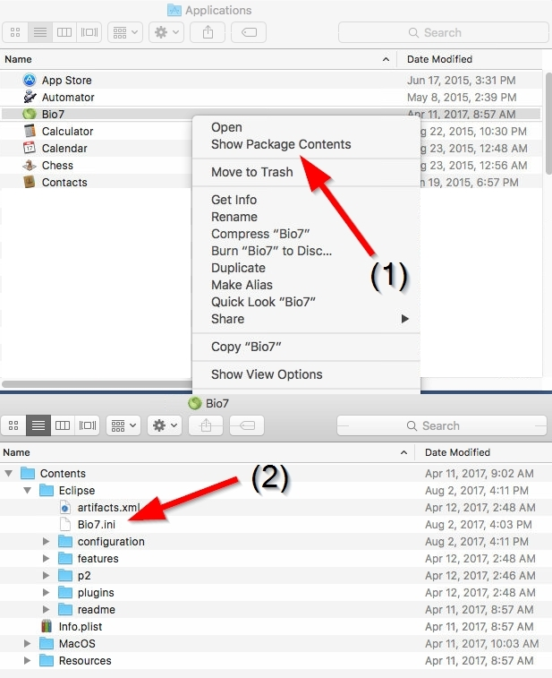

*Figure 2.14 Open the package (1) on MacOSX to change the Bio7.in file (2) for more Java memory, etc.*

[↑ Contents](#contents)

---

# 3 The Platform-Architecture

After Bio7 has been launched an Eclipse workbench window is displayed. A window contains a page with an arrangement of views and editors whose layout is defined by a perspective. The perspectives are switched in the perspective bar, views and editors can be moved, stacked, minimized, maximized (double-click on a tab) and detached.

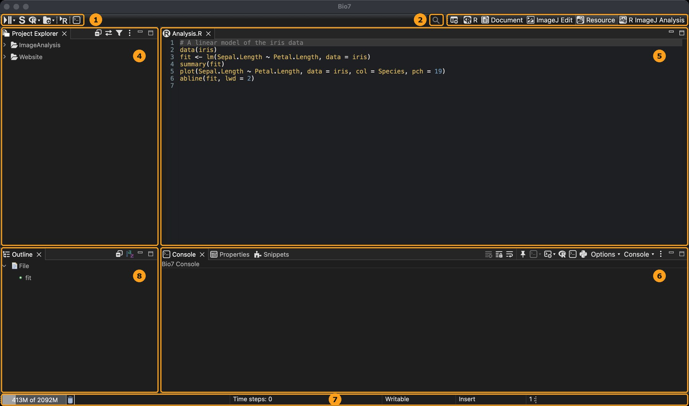

*Figure 3.1 The components of the Bio7 window (Resource perspective with an R script, dark theme)*

-   **(1) The main toolbar** with the actions of Bio7 and of the active editor (see below).
-   **(2) The search** (Ctrl/Cmd+3): finds commands, views, perspectives and preferences by their names.
-   **(3) The perspective bar**: opens and switches the perspectives (e.g., R, Document, ImageJ Edit, Resource, R ImageJ Analysis, 3d, WorldWind, Web, Custom).
-   **(4) and (8) Views**, e.g., the Project Explorer and the Outline.
-   **(5) The editor area** with the opened editors (e.g., the R editor).
-   **(6) Views below the editor**, e.g., the Console, the Properties and the Snippets.
-   **(7) The status line**: the memory (a click on the trash icon starts the garbage collection of Java), the selection, the time steps of a simulation (see Counter Reset) and the state of the editor (e.g., Writable, Insert, the line).

## 3.1 The Toolbar

The toolbar contains the default actions of Bio7 which are described below. Editors and plugins add their own actions to the toolbar (e.g., the actions of the active editor). The toolbar can be hidden with **Window &gt; Show/Hide Toolbar**.

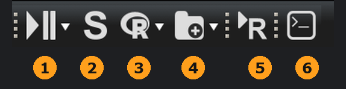

*Figure 3.2 The toolbar of Bio7 (with the action of the R editor)*

-   **(1) Play/Pause:** Starts or stops a simulation: the repeated, time based invocation of the run method of a compiled Java class (a class which extends the class Model). The menu of the action contains **Set Time Interval** (the interval of the invocation) and **Counter Reset** (sets the time steps of the status line to 0).
-   **(2) Setup:** Invokes the setup method of the compiled Java class (if available).
-   **(3) R:** Starts R with an Rserve connection (see <a href="README.md#46-the-r-perspective-and-menus" class="Reference">4.6↓</a>). The menu of the action contains **Start Rserve/Stop Rserve (within R)**, **Terminate R** and **Kill All R Processes** (if necessary).
-   **(4) Create Projects or Files:** Creates a project with a default file in one step: a Bio7 Java project (also with a WindowBuilder GUI, OpenGL, WorldWind or an ImageJ plugin), a project with an R, R Markdown, R Shiny, Python, Jython, Groovy, JavaScript, ImageJ macro or LaTeX file, a reproducible project or another project or file (**Other...**).
-   **(5) Editor actions:** The actions of the active editor, e.g., **Interpret R** for the R editor, the compilation of Java code for the Java editor or **Interpret ImageJ Macro** for the ImageJ macro editor.
-   **(6) Open a Terminal:** Opens a terminal (a shell of the operating system) in the Terminal view.

## 3.2 The Menu

The menu bar of Bio7 contains the menus for the work with the components of the application:

-   **File:** New projects and files, Save, Save All, Save As, Refresh, Import and Export of projects and files and **Restart in Debug Mode...** (a restart with a port for a Java debugger).
-   **Edit:** Undo, Redo, Cut, Copy, Paste, Delete, Find/Replace, Select All and Print for the editors of Bio7.
-   **Search:** The search in files and projects.
-   **Preferences:** Opens the preferences of Bio7 (see <a href="README.md#61-the-bio7-preferences" class="Reference">6.1↓</a>).
-   **Scripts:** Submenus with own scripts (BeanShell, Groovy, Jython, R scripts and ImageJ macros) of special folders (see <a href="README.md#104-install-eclipse-r-imagej-plugins-or-packages-in-bio7" class="Reference">10.4↓</a>).
-   **R:** The actions for the interaction with R and the transfer of data (see <a href="README.md#461-r-menus-in-the-bio7-main-menu" class="Reference">4.6.1↓</a>).
-   **Window:** **Show Selected View**, **Show View** and **Open Perspective**, **Show/Hide Editor**, **Show/Hide Toolbar**, **Show All Menus**, **Hide All Menus** and **Fullscreen/Hide Menus**, **Switch Theme...** (see <a href="README.md#105-bio7-themes" class="Reference">10.5↓</a>) and **Save Perspective As** (a custom arrangement of views).
-   **Help:** The help of the application, the dynamic help, **Bio7 Internet** (the Browser view), the installation of new software and updates (see <a href="README.md#8-update-manager" class="Reference">8↓</a>) and the About dialog (with the uninstallation of plugins).

LibreOffice can be connected with the R-Shell view and the Table view of Bio7 (see <a href="README.md#93-libreoffice-features-of-bio7" class="Reference">9.3↓</a>).

[↑ Contents](#contents)

---

# 4 The Perspectives of Bio7

In the perspective bar several different perspectives can be activated via the perspective buttons. All the views or editors in the perspective can be closed, opened, detached or moved. The perspectives in Bio7 can be extended with several other views which can be opened in the **Windows ▸ Views** menu or with the default action in the status bar at the bottom left of the program. Additionally self defined perspectives can be created or deleted. From the Eclipse Workbench User Guide (<http://help.eclipse.org>): “Perspectives provide combinations of views and editors that are suited to performing a particular set of tasks....”

To open a new perspective:

1.  Click the **Open Perspective** button on the shortcut bar on the left side of the Workbench window. (This provides the same function as the **Window ▸ Open Perspective** menu on the menu bar.)
2.  To see a complete list of perspectives, select **Other...** from the drop-down menu.
3.  Select the perspective that you want to open. When the perspective opens, the title bar of the window changes to display the name of the perspective. In addition, an icon is added to the shortcut bar, allowing you to quickly switch back to that perspective from other perspectives in the same window.

## 4.1 Resource Perspective

After Bio7 has been started the perspective in front is the Resource perspective. The parts of the Resource perspective are:

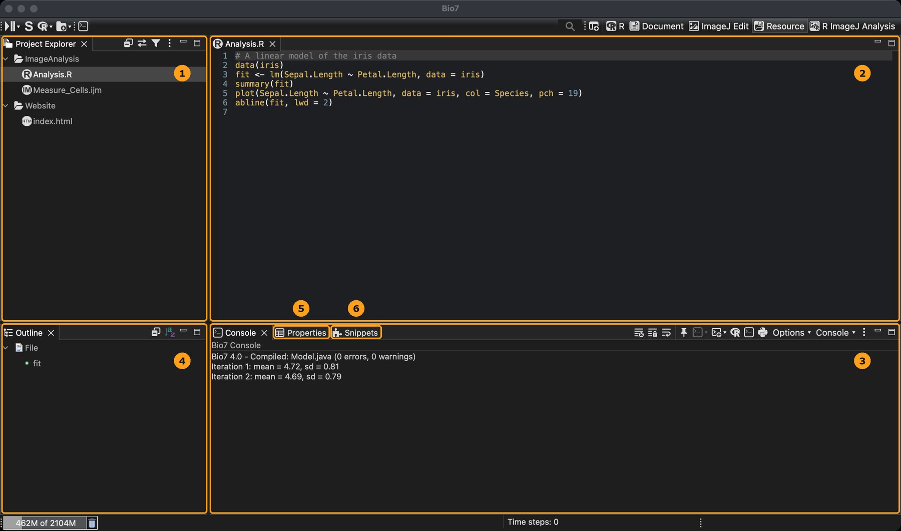

*Figure 4.1 The parts of the Resource perspective (dark theme)*

(1) The **Project Explorer** view to import, export, open and manage files.

(2) The **Editor** area where the editor files are opened.

(3) The **Console** of Bio7.

(4) The **Outline** view (active when an editor has been opened).

(5) The **Properties** view which shows the selected file properties .

(6) The **Snippets** view in which snippets for the different text based editors of Bio7 can be created.

The context menu of the Project Explorer (a right-click) contains several file actions. Some actions are only visisble if a special file type is selected (e.g. the **R Packages** actions are only visible when an R file is selected).

### 4.1.1 The Project Explorer

In the Project Explorer files can be managed and stored. The context menu offers several actions to import and export files for the available Bio7 editors and specialized actions dependant on the selected filetype. All the files are managed by projects which can have folders and subfolders, etc. for managing a large amount of different files. These projects and their files can be exported or imported as \*.zip files for data exchange. The file navigator (**Project Explorer** view) of Bio7 allows you to create different editor files with a help of a file wizard. A double-click on the file in the file navigator will open the file in the default registered editor.

### 4.1.2 The Editor Area

The editor area is the area where all files are opened and edited. The context menu varies depending on which file is opened. When opened the text based editors offer typical text functionalities like: Copy, Paste, Undo, Redo, Cut, Find/Replace, Print, etc. in the context menu and in the edit menu (menubar) of Bio7. When a file has been opened editor specific buttons will be added to the toolbar which execute an editor action according to the opened file (compilation respectively interpreting code of Java, BeanShell, Groovy, Jython , R or execution of a Flow!). The editor area can be enabled in every perspective with the **Window ▸ Show/Hide Editor** action in the main Bio7 menu.

### 4.1.3 The Console of Bio7

The Bio7 console gives access to several interpreted languages and a pseudo-terminal for the Operating System (OS) environment. In the view menu the different modes can be selected.

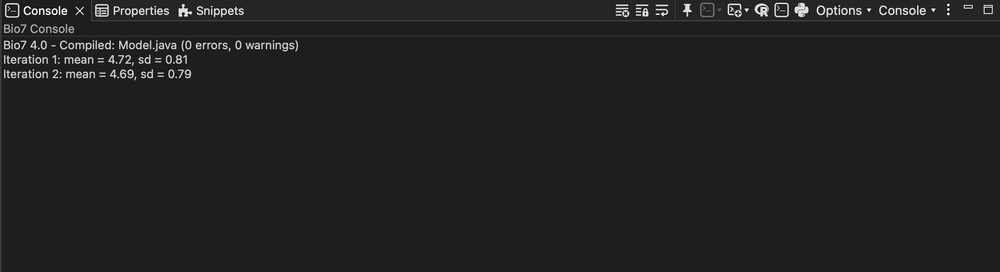

*Figure 4.2 The Console view of Bio7 (the Options and Console menus are in the toolbar of the view)*

1.  The script consoles (**Beanshell, Groovy, Jython**) can interactively communicate with the Bio7 application or simply interpret different instructions in the selected scripting language.
2.  The **Shell** pipes commands to the underlying OS with a pseudo-terminal.
3.  The **Native R** and **Native Python** consoles pipe commands to the different applications (Please adjust the paths to the language environments in the Preferences! See: <a href="README.md#101-native-preferences" class="Reference">10.1↓</a>).
4.  The default enabled **Console Output** only displays errors and prints messages. In addition it pauses the REPL (read–eval–print loop).The Console is responsible for the:
    1.  Output messages for the interpreters and connected applications.
    2.  Output messages of the embedded Java compiler (compiler warnings, infos, etc.)
    3.  Output of the R interpreter (Rserve warnings, etc.) and evaluated expressions in R.

In the context menu of the Console view several actions are available to clear displayed text or copy text from the console to the clipboard.

#### 4.1.3.1 Menu of the Console View

In the **Options** menu of the Console view text encoding properties, font settings and special interpreter commands can be selected. As already noted in the **Console** menu the different interpreters and native connections (R, Python, OS shell) can be selected.

### 4.1.4 The Snippets View

In the Snippets view code templates can be created and stored for the different editors in Bio7. The Snippet view plugin comes from the WTP project (<https://eclipse.org/webtools/wst/components.html>). To create snippets inside this view, categories have to be created inside a template editor (**Customize...** action in the context menu). This editor can be opened with a right-click in the Snippets view. Copied text from any text based editor of Bio7 can be pasted directly as a snippet after a category has been created inside the view. In addition selected text in an editor can be stored as a template. More complex templates with variables and a detailed description can be created, too. This is extremely useful if you want to create custom formulas or statistics. A created template can be transferred to an active opened editor with a double-click of the mouse device. Optional the different categories can also be folded and customized for a better overview (see figure below).

**Note:** By default every text based editor of Bio7 has an integrated template editor for the different programming languages with default snippets.

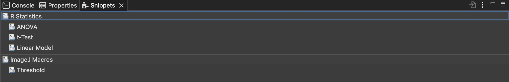

*Figure 4.3 The Snippets view with two categories of snippets*

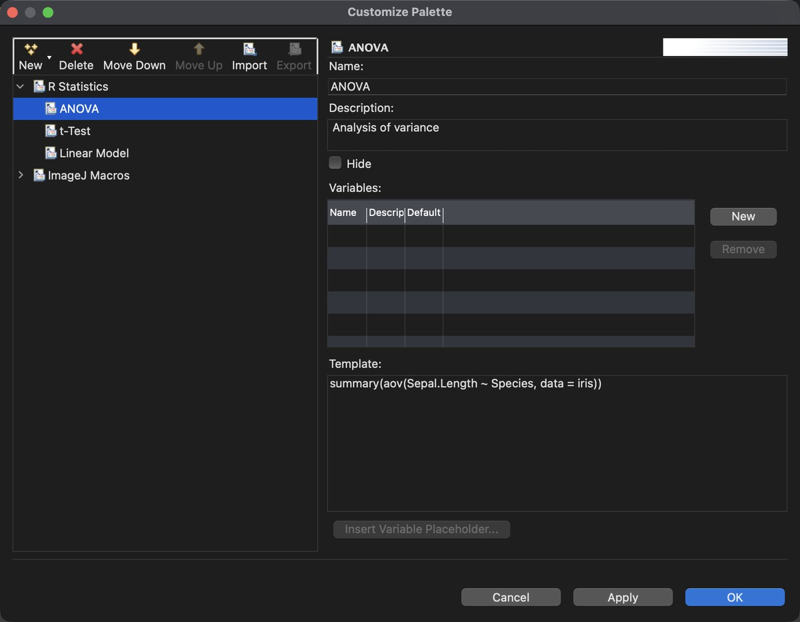

*Figure 4.4 The Customize... dialog of the Snippets view available in the context menu*

## 4.2 ImageJ Edit Perspective

The ImageJ Edit perspective is the default perspective for image analysis and supports the creation of ImageJ macros, scripts and Java plugins. ImageJ macros, etc. can directly be opened and edited in a Bio7 editor (BeanShell, Groovy, Jython, JavaScript, ImageJ Macro, Java plugins) from the Project Explorer and executed with the interpret action in the main toolbar of Bio7. The perspective contains the Project Explorer, the Thumbnails view, the editor area, the Outline, the Console and the debug view of the ImageJ macro editor and on the right side the **ImageJ-Canvas** view.

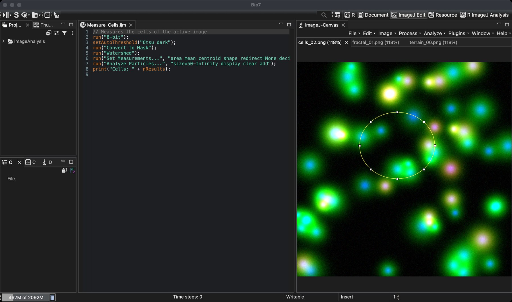

*Figure 4.5 The ImageJ Edit perspective with a macro and images in the ImageJ-Canvas view (dark theme)*

### 4.2.1 SWTImageJ in Bio7

Bio7 embeds **SWTImageJ**, a version of ImageJ with a native SWT user interface (instead of the former AWT version which was embedded with the SWT\_AWT bridge). The images, the menus, the toolbar, the dialogs and the tools of ImageJ are SWT widgets, so they follow the theme of Bio7 (e.g., the dark theme) and work well on high DPI displays. For a description of ImageJ see https://imagej.net/ij/ and the user guide https://imagej.net/ij/docs/guide/. The differences to the regular version of ImageJ are:

-   The images are displayed in the tabs of the **ImageJ-Canvas** view or as **detached image views** (see below). An image becomes active when its tab or view is selected.
-   The menu of ImageJ (File, Edit, Image, Process, Analyze, Plugins, Window, Help) is the menu of the ImageJ-Canvas view.
-   The toolbar of ImageJ (with the status line and the progress bar) is the **ImageJ-Toolbar** view.
-   Two actions compile or interpret the source of the active editor on the classpath of ImageJ: **Plugins &gt; Compile Java (Eclipse)** and **Plugins &gt; Interpret Script (Eclipse)**.
-   The actions for the transfer of image data to and from R are available in the **Image-Methods** view (**Window &gt; Bio7-Toolbar**, see <a href="README.md#43-r-imagej-analysis-perspective" class="Reference">4.3↓</a>).
-   Installed plugins extend the menus of the ImageJ-Canvas view. Macros can extend the main menu of Bio7 and can be created like in the regular version.
-   Images, folders (as a stack) and plugins can be dropped on the ImageJ-Canvas view.
-   The ImageJ API is accessible with the embedded Java compiler and with BeanShell, Groovy, JavaScript, ImageJ Macro or Jython scripts. Many examples of the ImageJ website can be executed directly in the editors of Bio7.

#### 4.2.1.1 Image Views and the Window Menu

An image can be displayed in its own view: **Window &gt; Open Current Image as View** detaches the active image, **Window &gt; Open All Images As Views** detaches all images and with **Window &gt; Open Images As Views By Default** new images are opened as views (also a preference). By default a detached view is opened in its own window which follows the active perspective (see the ImageJ preferences). Closing the view closes the image. Many images (e.g., the images of a stack, Image &gt; Stacks &gt; Stack to Images) are opened as views quickly in one step.

**Window &gt; Cascade Image Views** and **Window &gt; Tile Image Views** arrange the windows of the image views: cascaded (with the sizes of the windows) or as a grid which fills the monitor. With more than one monitor a submenu selects the monitor. **Window &gt; Fullscreen Image (F2)** displays the active image in the fullscreen mode (F2 the primary monitor, F3 the secondary, F4 the tertiary, F5 a selected monitor, Escape exits).

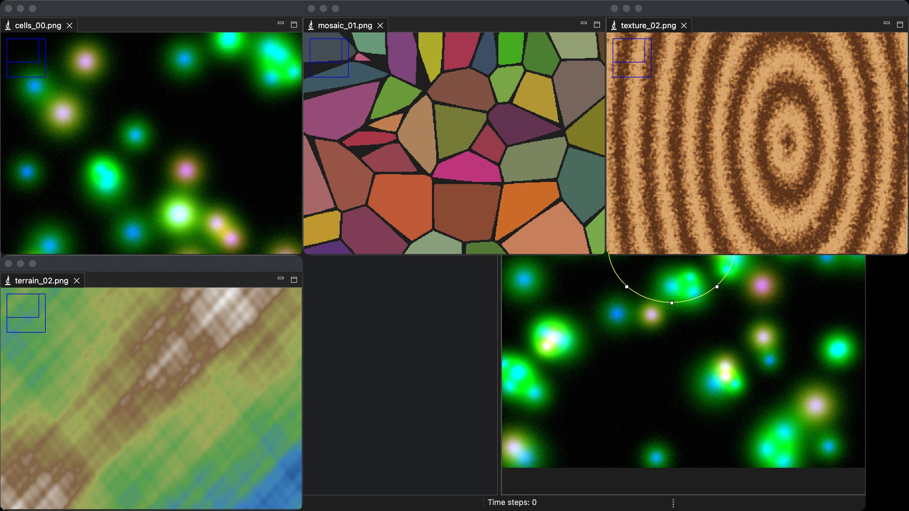

*Figure 4.6 Image views in windows, arranged with Window &gt; Tile Image Views*

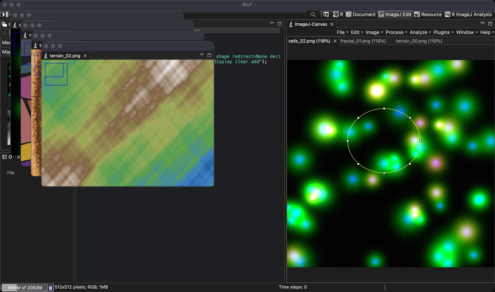

*Figure 4.7 Image views arranged with Window &gt; Cascade Image Views*

#### 4.2.1.2 ImageJ Toolbar

The toolbar of ImageJ is the **ImageJ-Toolbar** view (**Window &gt; ImageJ-Toolbar**, in the R ImageJ Analysis perspective below the editor area). It contains the tools of ImageJ, the status line and the progress bar. A double-click or a right-click on a tool opens its options like in ImageJ. Macros for the toolbar can be installed (as known from ImageJ).

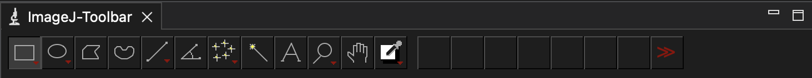

*Figure 4.8 The ImageJ-Toolbar view*

#### 4.2.1.3 ImageJ Plugins and Macro Paths

Bio7 supports plugins and macros for ImageJ. The default folders are:

-   Bio7/plugins/com.eco.bio7.image\_x.x.x/plugins
-   Bio7/plugins/com.eco.bio7.image\_x.x.x/macros

Plugins which are copied into the plugins folder extend the menu **Plugins** with submenus. **Plugins &gt; Utilities &gt; Control Panel** displays all installed plugins. The **SWTImageJ LLM Assistant** (a plugin which connects SWTImageJ with OpenAI compatible language models, e.g., of OpenAI, LM Studio or Ollama) is installed by default. Its window can be docked as a custom view of Bio7 and its code tools mark errors, warnings and infos in the editors of Bio7 (a quick fix is applied with a double-click on the marked text).

#### 4.2.1.4 ImageJ Preferences

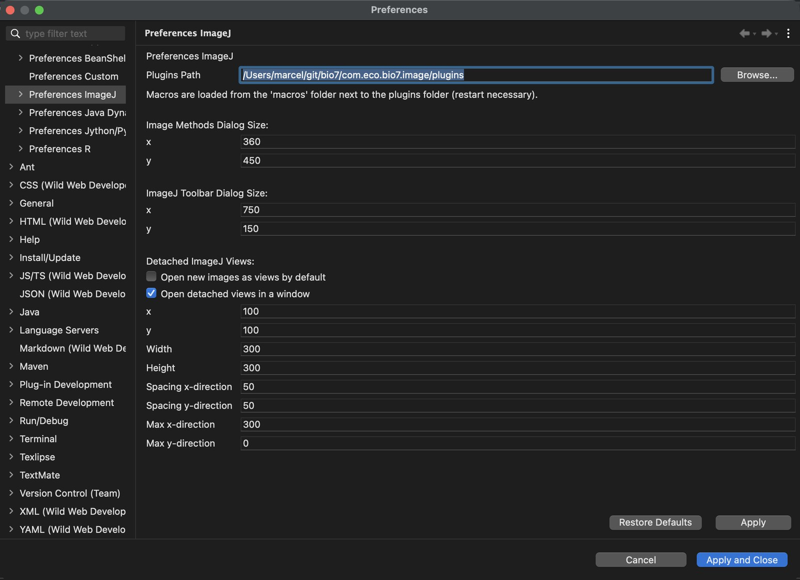

*Figure 4.9 The ImageJ preferences*

In the ImageJ preferences (**Preferences Bio7 &gt; Preferences ImageJ**) the **Plugins Path** can be changed (the macros are loaded from the macros folder next to the plugins folder, a restart is necessary), the size of the Image Methods and the ImageJ toolbar dialogs and the settings of the detached image views: **Open new images as views by default**, **Open detached views in a window** and the position, the size and the spacing of new image windows. The subpages contain the preferences of the ImageJ macro editor (colors, code, templates, etc.).

#### 4.2.1.5 Compilation of ImageJ Plugins

ImageJ plugins can be compiled with the compile action of ImageJ (e.g., **Plugins &gt; New &gt; Plugin**) or with the Java editor of Bio7 (**Plugins &gt; Compile Java (Eclipse)**). The file creation wizard of Bio7 contains templates for ImageJ plugins and filters.

## 4.3 R ImageJ Analysis Perspective

The R ImageJ Analysis perspective combines image analysis with statistical analysis: the R tools (R-Shell, Packages, Console, Plot, R Snippets, the editor area) and the ImageJ tools (the ImageJ-Canvas view, the ImageJ-Toolbar, the Image-Methods view and the Geometry Selections view) are arranged side by side.

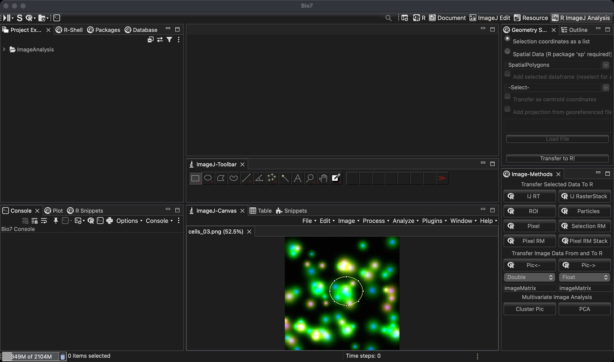

*Figure 4.10 The R ImageJ Analysis perspective*

### 4.3.1 ImageJ Interactions with R

The **Image-Methods** view (**Window &gt; Bio7-Toolbar** in the ImageJ-Canvas menu, displayed by default in the R ImageJ Analysis perspective) contains the actions to transfer image data to and from R (a connection to R is necessary, see the R perspective).

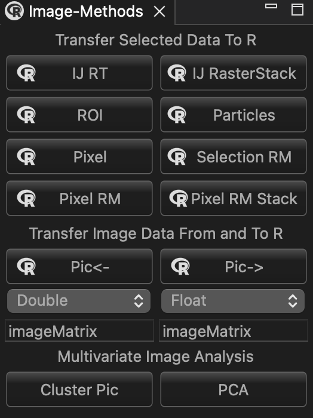

*Figure 4.11 The Image-Methods view*

Transfer Selected Data To R

-   **IJ RT:** Transfers the values of an opened ImageJ Results Table to R as a dataframe.
-   **IJ RasterStack:** Transfers an opened ImageJ stack as a list of matrices or (with the option Raster?) as a RasterStack to R. The data type is selected in the combo box below Pic&lt;-.
-   **ROI:** Transfers the x, y coordinates of the current selection (ROI) to R.
-   **Particles:** Opens the Analyze Particles dialog of ImageJ, the results of the particle analysis are transferred to R as a dataframe.
-   **Pixel:** Transfers the selected pixels (freehand, rectangle, etc.) of one or several images with or without a signature as a matrix to R.
-   **Selection RM:** Transfers the coordinates of the selections of the ROI Manager as a list of lists to R (see the Geometry Selections view for spatial data).
-   **Pixel RM:** Transfers the pixels of the selections of the ROI Manager (all images) with or without a signature as a matrix to R.
-   **Pixel RM Stack:** Transfers the pixels of the selections of the ROI Manager for all slices of a stack with or without a signature as a matrix to R.

Transfer Image Data From and To R

-   **Pic&lt;-:** Transfers the image data of the active image to R with the name of the text field below and the data type of the combo box (**Double**, **Integer**, **Byte** or **RGB Byte**).
-   **Pic-&gt;:** Creates an image from an R matrix or vector (the name of the R object in the text field below) with the image type of the combo box (**Colour**, **Greyscale**, **Float**, **Short** or **Double**). The type Double creates a 64-bit double image of SWTImageJ (the values of R without a conversion to float).

Multivariate Image Analysis

-   **Cluster Pic:** Performs a cluster analysis (clara or kmeans) and creates a new image from the assigned pixels.
-   **PCA:** Performs a principal component analysis and creates new images from the components.

#### 4.3.1.1 Image Transfer to R

With **Pic&lt;-** and **Pic-&gt;** the data of the active image are transferred to R or image data from R to ImageJ in a selected data type (image type). It is good practice to transfer the image data in the smallest data type needed for a task. In addition special transfers are available for selected image data:

-   **Pixel** transfers the data of the current selection (one selection) of one or several images (opened tabs or views) in the selected data type without the ROI Manager.
-   **Pixel RM** transfers the pixels of the selections of the ROI Manager (the selected selections or all selections if none is selected) for all opened images with a selected or an incremental signature. If a stack is among the opened images only the first slice is transferred.
-   **Pixel RM Stack** transfers the pixels of the selections of the ROI Manager for all slices of a stack (e.g., multispectral or hyperspectral image data) with a selected or an incremental signature.

Note that image folders can be dropped on the ImageJ-Canvas view to load the images as a regular or virtual stack (in a virtual stack only the displayed image is loaded into the memory). A description of the ROI Manager can be found in the ImageJ user guide.

#### 4.3.1.2 Supervised Classification with ImageJ and R

The custom class signatures of **Pixel RM** and **Pixel RM Stack** are especially useful for a supervised classification of image data in R: every selection could represent a vegetation or a tissue type (e.g., a plant species or a tumor) with several spectral bands (the slices of a stack) for the training of a classifier. See the Bio7 examples (https://github.com/Bio7/Bio7) and the Bio7 classification plugin (https://github.com/Bio7/Bio7\_Classification).

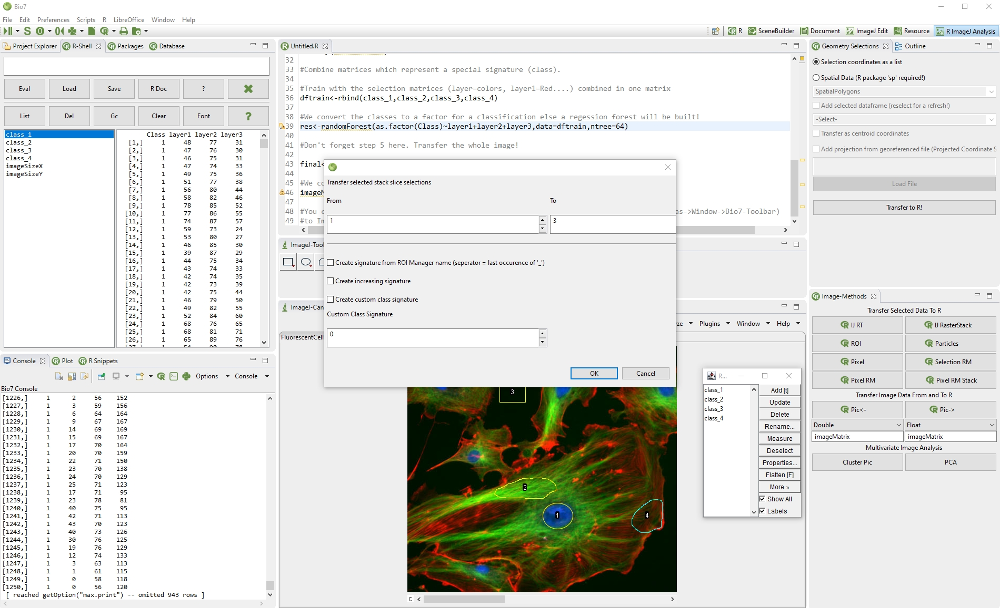

*Figure 4.12 Pixel RM Stack: the transfer of the selected pixels of a stack (RM = ROI Manager)*

#### 4.3.1.3 Transfer of Selection Coordinates

With **ROI** single and with **Selection RM** multiple selection coordinates can be transferred to R, e.g., for a shape analysis or morphometrics. ImageJ has several actions to edit the selections in the menu **Edit &gt; Selection**, e.g., an interpolation with a spline or the convex hull to reduce the number of points.

#### 4.3.1.4 Geometry Selections View

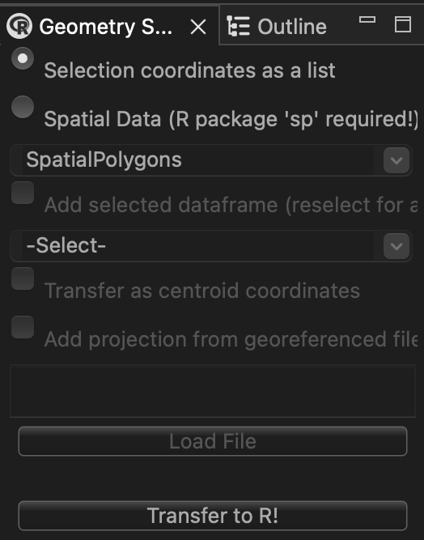

*Figure 4.13 The Geometry Selections view*

The **Geometry Selections** view transfers the selections of the ROI Manager:

-   **Selection coordinates as a list**: the selections as a list of coordinates.
-   **Spatial Data (R package ’sp’ required!)**: the selections as SpatialPolygons, SpatialLines or SpatialPoints (with an R dataframe as SpatialPolygonsDataFrame, SpatialLinesDataFrame or SpatialPointsDataFrame, see **Add selected dataframe**).

**Transfer as centroid coordinates** transfers the selections with the centers of the grid cells instead of the top left corners (e.g., for point data). **Add projection from georeferenced file** adds the projection of a georeferenced raster image (e.g., \*.geotiff, a projected coordinate system) to the spatial object in R: the projection is read with GDAL or, if GDAL is not available, with the R package terra. **Transfer to R!** creates the objects in the R workspace.

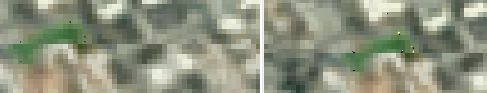

*Figure 4.14 Transfer of point selections as centroids (left: GIS display of the transferred point vector data, right: the selections in ImageJ)*

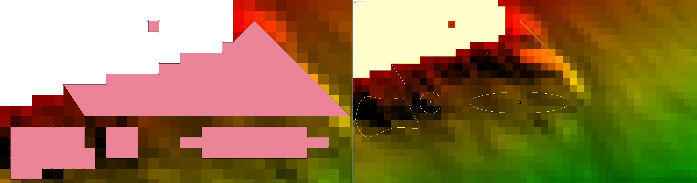

*Figure 4.15 Transfer of different selection types (right) and the result in a GIS display (left)*

#### 4.3.1.5 Cluster and PCA Analysis

**Cluster Pic** and **PCA** open dialogs for an unsupervised classification (the algorithms clara and kmeans) and a principal component analysis of the image data. In the dialog the number of clusters (components) can be specified and arguments can be added. The images (opened tabs or views) for the analysis are selected in the lists. **Only Transfer** transfers the image data to R without an analysis. The data type (Pic&lt;-) can reduce the memory of the analysis drastically.

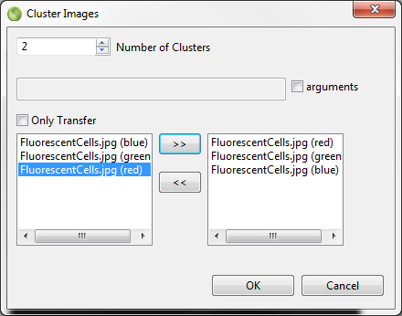

*Figure 4.16 The dialog of the cluster analysis with the selected images*

### 4.3.2 Thumbnails

The **Thumbnails** view displays the images of a folder as thumbnails: in the context menu of the Project Explorer select **Open in Thumbnail view** on a folder or select a folder with **Open** in the view. The thumbnails are created in parallel and cached in the memory and on the disk, so that thousands of images are displayed fast and a second display of a folder is immediate.

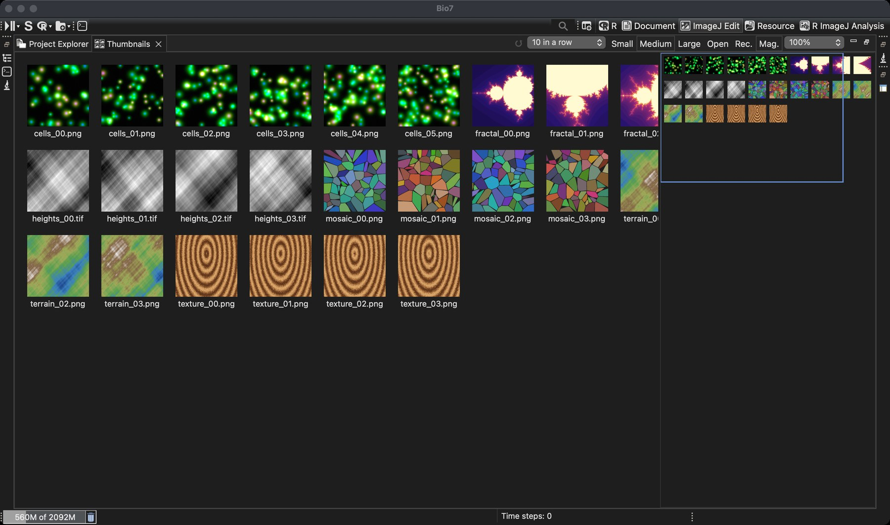

*Figure 4.17 The Thumbnails view (maximized) with the overview on the right side*

-   **Images in a row:** The number of thumbnails in a row or Fit width (the combo box).
-   **Small, Medium, Large:** The size of the thumbnails (50, 100 or 200 pixels).
-   **Open:** Selects the folder which is displayed. **Rec.** includes the images of the subfolders (recursive).
-   **Mag.:** Shows or hides the overview of all thumbnails at the right side. The blue rectangle shows the visible part and can be moved.
-   **Zoom:** The zoom of the thumbnails (the combo box).
-   **Refresh:** Lists the folder again and reloads the thumbnails.

The images which ImageJ opens are displayed (e.g., \*.tif, \*.png, \*.jpg, \*.gif, \*.bmp, \*.dcm), an \*.avi file with its first frame, a \*.zip file with the first image of a stack (or the ROIs of a ROI Manager file), \*.roi and \*.txt files (e.g., macros, results) with an icon. A folder with LUT files (\*.lut) displays a sample image with each LUT: a click on the thumbnail applies the LUT to the active 8, 16 or 32-bit image.

#### 4.3.2.1 Mouse and Keys of the Thumbnails View

-   A double-click opens the image in ImageJ, a double-click with the right mouse button opens the folder of the image.
-   Hovering over a thumbnail displays the information of the image in a popup (a click keeps the popup open).
-   The arrow keys, Home, End, PageUp and PageDown move the selection, Enter opens the selected image.

## 4.4 The 3d Perspective

The 3d perspective of Bio7 visualizes data, models and simulations in an OpenGL view (Jogl). It combines several tools in one 3D view: an interactive **plot API** for 3D plots and charts (surfaces, scatter plots, bars, box plots, pie charts, etc.) with an export to an interactive web page (WebGL) or to Blender, the display of **height maps** from ImageJ images, the **volume rendering** and **iso surfaces** of ImageJ stacks with clipping, cuts and 3D **measurements**, the import of **3D models** (\*.obj, \*.stl, \*.ply, \*.off) and custom **OpenGL code** (Java) for models and simulations. In addition interactive **HTML simulations** can be exported which run in a web browser.

The 3d perspective can be opened in the perspective bar of Bio7 (3d). By default it contains the **Space** view (the 3D view), the **Options Space** view with the settings of the 3D view, the Console and the Project Explorer.


*Figure 4.18 The 3d perspective with a surface plot of the plot API (dark theme)*

### 4.4.1 The Space View

The **Space** view displays the 3D scene: the axes, the box of the data, grids, plots, height maps, volumes, iso surfaces and models. With the mouse the view can be rotated (an "Arcball" interface), moved and zoomed (see the table below). The z-axis points to the user (the OpenGL coordinate system is right-handed). The orientation of the axes is displayed in the top right corner of the view.

| **Device**          | **Event**                 | **Function**                                                                |
|:--------------------|:--------------------------|:----------------------------------------------------------------------------|
| Left mouse button   | Drag                      | Rotation                                                                    |
| Right mouse button  | Drag left, right          | Move forward, backward (zoom)                                               |
| Middle mouse button | Drag                      | Move up, down, left, right                                                  |
| Left mouse button   | Click on an object number | Selects a measured object (Measure tab)                                     |
| Key                 | Arrow keys                | Move the view (walkthrough: rotate and move the camera)                     |
| Key                 | PgUp, PgDn                | Move up, down (walkthrough)                                                 |
| Key                 | F2                        | Fullscreen on the primary monitor (exits the fullscreen mode in fullscreen) |
| Key                 | F3, F4                    | Fullscreen on the secondary or tertiary monitor                             |
| Key                 | F5                        | Fullscreen on a selected monitor                                            |
| Key                 | Escape                    | Exit the fullscreen mode                                                    |

Table 4.1 The mouse and the keys of the Space view

The toolbar of the Space view contains the actions **Reset View** (the default rotation and distance), **Clear Measurements** (the colors and numbers of measured objects and the picked points) and - if enabled for a plot - **Export Plot (WebGL, Blender)** (see <a href="README.md#4433-export-of-plots-webgl-gltf-blender" class="Reference">4.4.3.3↓</a>).

#### 4.4.1.1 Custom OpenGL Code

Custom OpenGL commands can be written in the Java editor as regular Java code. With the Bio7 wizard a new OpenGL file can be created. Two parameterized methods (setup, run) are created which make the gl (glu, glut) context available to draw custom shapes and develop models in a 3-dimensional space. After the compilation the execution is enabled in the **Time** tab of the Options Space view.

```
public void setup(GL2 gl, GLU glu, GLUT glut) {
    // Please enter your Java OpenGL setup code here
}

public void run(GL2 gl, GLU glu, GLUT glut) {
    // Please enter your Java OpenGL code here
}
```

Table 4.2 Classbody Java OpenGL

Since OpenGL is single-threaded the run method is executed from the internal OpenGL display method of the 3D view. TextRenderer objects, textures and models should be created in the setup method with the current OpenGL context (the setup method is invoked again, e.g., after a switch to the fullscreen mode). Several examples demonstrate the use of OpenGL in Bio7.

### 4.4.2 The Options Space View

The **Options Space** view contains the settings of the 3D view in several tabs: **Space**, **Time**, **Camera**, **Light**, **Render**, **Model**, **Heightmap**, **Volume**, **Iso Surface**, **Clipping** and **Measure**. Tabs which don’t fit into the view are available in the list at the right of the tabs (»). Most controls show a short description as a tooltip.

#### 4.4.2.1 Space

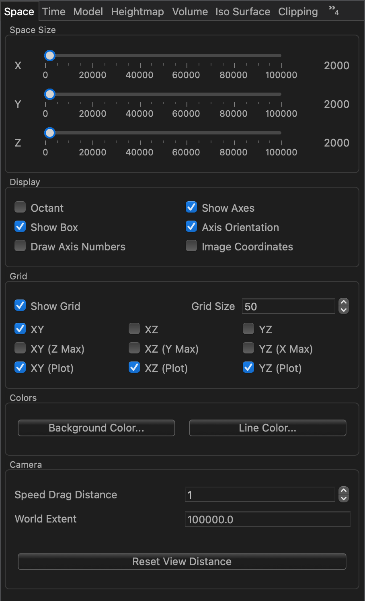

*Figure 4.19 The Space tab*

-   **Space Size:** The size of the space (the axes from -size to +size) in x, y and z.
-   **Display:** **Octant** displays the first octant only (e.g., for a 3D plot). **Show Axes**, **Show Box** (the box fitted to the displayed data) and **Axis Orientation** (the orientation of the axes in the top right corner) toggle the components of the view. **Draw Axis Numbers** draws the numbers and ticks of the axes, **Image Coordinates** displays the axis numbers as pixel coordinates of a texture image (y from the top like in ImageJ).
-   **Grid:** **Show Grid**, the **Grid Size** (the distance of the grid lines) and the grids: through the origin (XY, XZ, YZ), at the far side of the box (Max) and the grids of the plot view behind the data (Plot).
-   **Colors:** The **Background Color** of the space and the **Line Color** of the grids, axes and the box.
-   **Camera:** The **Speed Drag Distance** (a factor for the speed of the zoom with the mouse), the **World Extent** (the distance of the far plane) and **Reset View Distance** (the default view distance fitted to the displayed data).

#### 4.4.2.2 Time

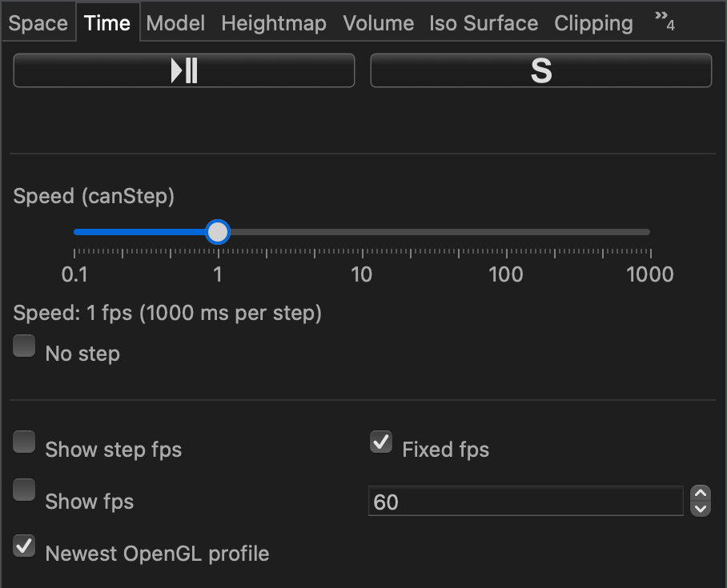

*Figure 4.20 The Time tab*

After the compilation of custom OpenGL code the execution is enabled with **Play/Pause** in the Time tab. The run method is invoked by the OpenGL timer. The **S** button invokes the setup method of the compiled class. The speed of a simulation can be controlled with the method canStep() which returns true with the speed of the slider **Speed (canStep)** (in steps per second). **No step** sets canStep() to false (a pause). **Show step fps** and **Show fps** display the frame rates in the view. With **Fixed fps** the rendering speed is limited to the selected frame rate (else the default of 60 fps). **Newest OpenGL profile** uses the newest OpenGL compatibility profile of the system (e.g., OpenGL 4 on Windows and Linux, OpenGL 2.1 on macOS).

#### 4.4.2.3 Camera

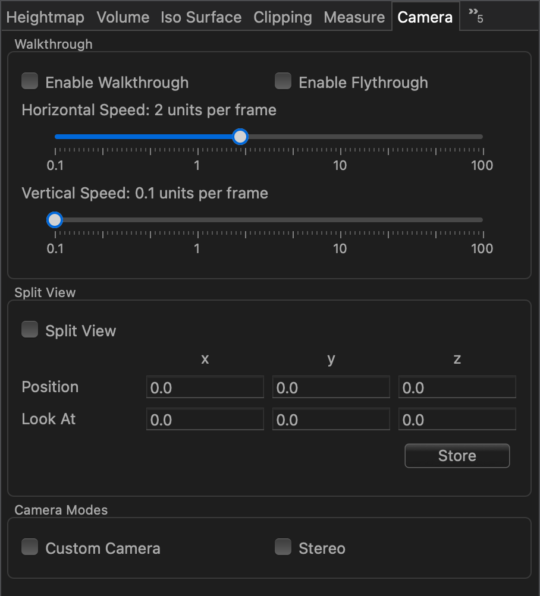

*Figure 4.21 The Camera tab*

**Enable Walkthrough** moves the camera with the arrow keys (Ctrl: sideways) in the x, z plane. With **Enable Flythrough** the camera moves up and down in the view direction, too. The horizontal and vertical speed is set with the sliders. **Split View** shows a second camera in the bottom left corner of the view (the **Position** and the **Look At** coordinates can be set and stored). **Custom Camera** uses the coordinates of a custom camera (e.g., set by a script with SpatialUtil.setCustomCamera). **Stereo** enables an anaglyph stereo view (red/cyan glasses).

#### 4.4.2.4 Light

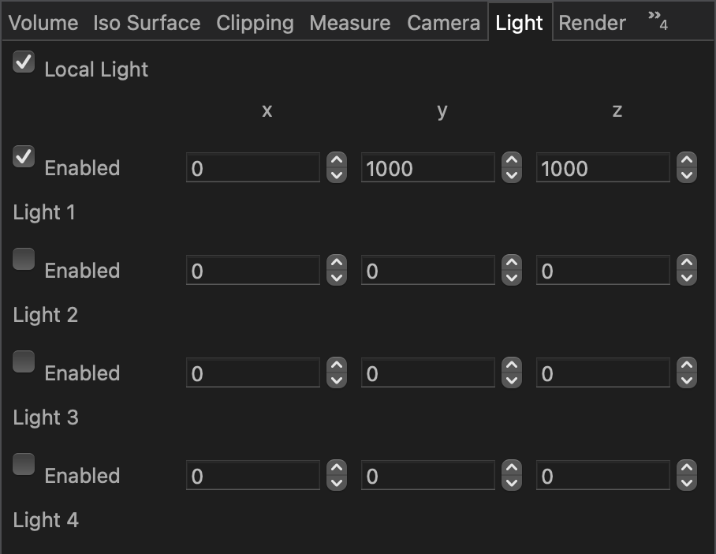

*Figure 4.22 The Light tab*

Four light sources can be enabled and positioned (x, y, z). With **Local Light** (recommended) the lights rotate with the view like a fixed lamp. Lights have a visible effect for surfaces with normals (e.g., height maps, plots, iso surfaces and models).

#### 4.4.2.5 Render

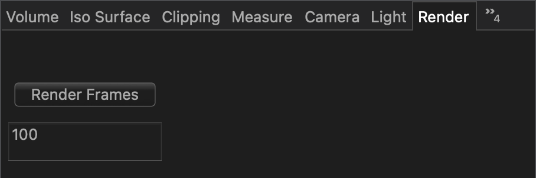

*Figure 4.23 The Render tab*

**Get Image** transfers a screenshot of the 3D view as an image to ImageJ. **Rec.** renders the frames of the 3D view to an ImageJ stack until the rendering is stopped or the number of frames (**Render Frames**) is reached. The stack can be saved, e.g., as an \*.avi file or an animated \*.gif file. The size of the 3D view determines the size of the images (a resize stops the rendering).

#### 4.4.2.6 Model

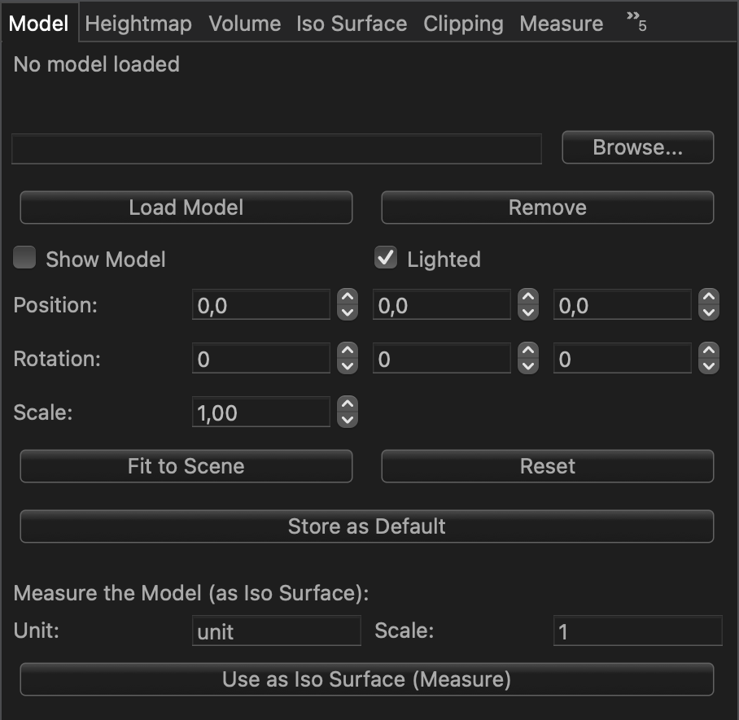

*Figure 4.24 The Model tab*

A 3D model can be loaded as a mesh file: \*.obj (with materials and textures), \*.stl, \*.ply (with colors) or \*.off (e.g., exported from Blender or another 3D software). **Show Model** displays the model, **Lighted** enables the lighting with the activated lamps. The **Position**, **Rotation** and **Scale** can be adjusted, **Fit to Scene** centers and scales the model to the grid (or to a displayed texture, volume or iso surface). **Store as Default** stores the settings for the next start.

With **Use as Iso Surface (Measure)** the model is displayed as an iso surface. Then the measurements (Measure tab), the clipping and the export of the iso surface are available for the model, too (with the **Unit** and the **Scale** of one unit of the file).

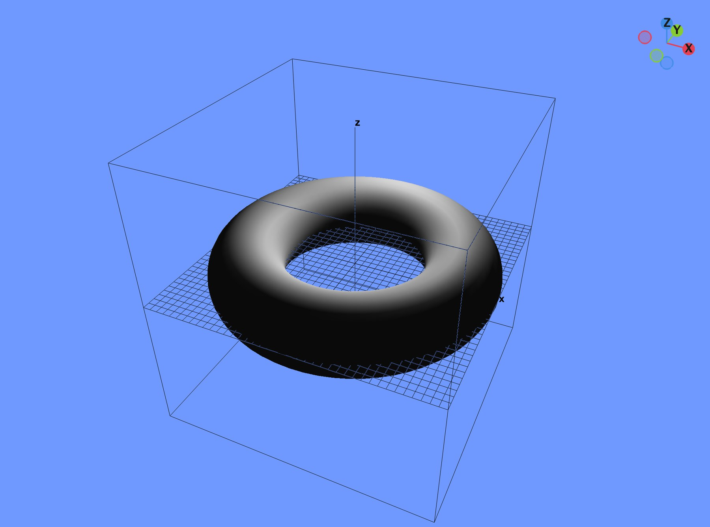

*Figure 4.25 A model (\*.obj) in the 3D view*

#### 4.4.2.7 Heightmap

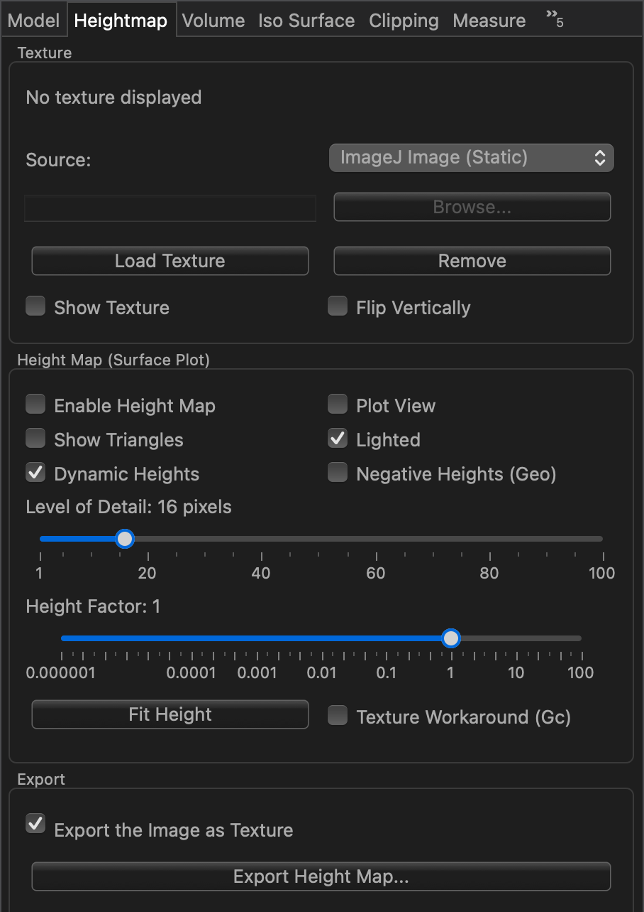

*Figure 4.26 The Heightmap tab*

The **Texture** group displays an image as a textured plane: the active ImageJ image (static, load again after changes, e.g., of the LUT), the active ImageJ image (dynamic, the texture is updated with the image) or an image file. **Flip Vertically** flips the texture, height map, volume and iso surface (by default the image is displayed like in ImageJ with 0,0 at the top left).

The **Height Map** group displays the pixel values of the active ImageJ image (8-bit, 16-bit, 32-bit, e.g., a digital elevation model or a measurement as a 32-bit image) as the heights of a surface which is textured with the selected texture. **Plot View** displays the height map as a surface plot with the axes, the box and the grids of the plot API. **Show Triangles** draws the triangles, **Lighted** enables the lighting, **Dynamic Heights** updates the heights directly from the active image and **Negative Heights (Geo)** scales the heights negative for a geographic view. The **Level of Detail** (the distance of the vertices in pixels) and the **Height Factor** (logarithmic) can be adjusted. **Fit Height** sets the height factor so that the range of the heights is half of the longer side of the image.

With **Export Height Map...** the height map is exported as a 3D mesh with the colors of the image (LUT): glTF binary (\*.glb, with the texture, e.g., for Blender), OBJ (with the texture as \*.png), PLY (with vertex colors) or STL (3D printing).

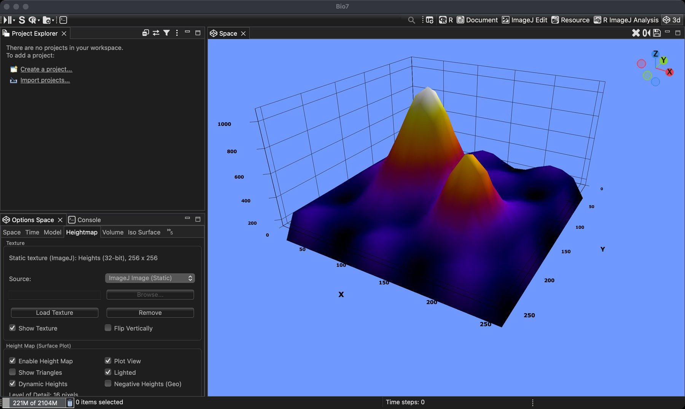

*Figure 4.27 A height map of a 32-bit ImageJ image (Fire LUT as texture) in the plot view*

#### 4.4.2.8 Volume

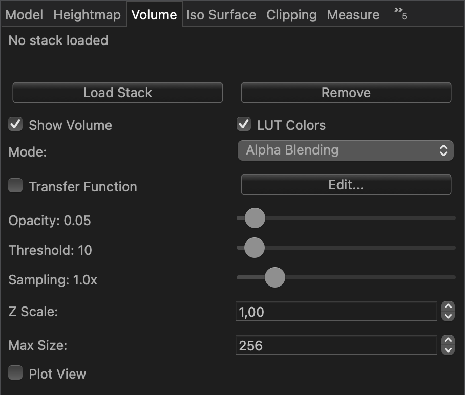

*Figure 4.28 The Volume tab*

**Load Stack** loads the active ImageJ stack as a volume (with the current LUT and the display range, load again after changes of the stack). **LUT Colors** uses the colors of the LUT (else gray values). The **Mode** is **Alpha Blending** (transparent voxels, see Opacity) or **Maximum Intensity** (the maximum along the view direction). With a **Transfer Function** the colors and opacities of the voxels are defined in an editor (**Edit...**, an opacity curve and a color map). The **Opacity**, the **Threshold** and the **Sampling** (quality) can be adjusted. **Z Scale** scales the depth of the volume (by default the calibrated voxel depth), larger stacks are reduced to the **Max Size**. **Plot View** displays the volume with the axes of the plot API.

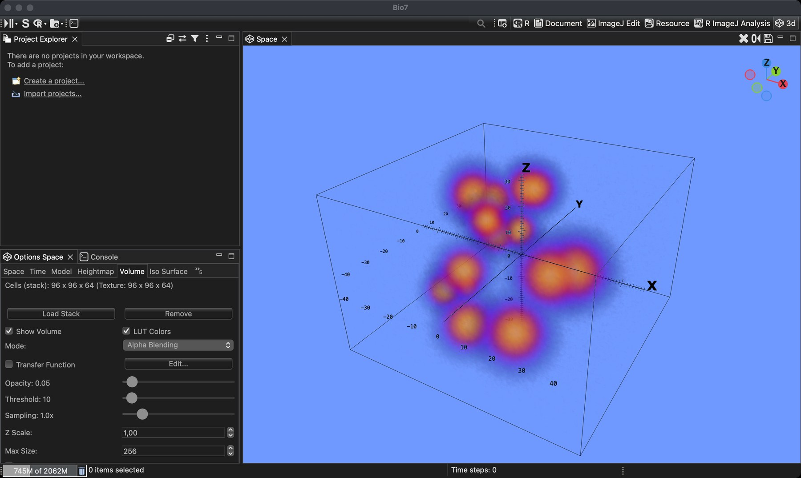

*Figure 4.29 The volume rendering of an ImageJ stack (Fire LUT)*

#### 4.4.2.9 Iso Surface

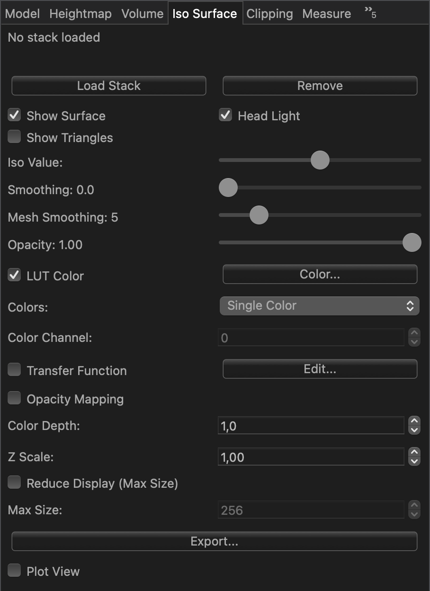

*Figure 4.30 The Iso Surface tab*

**Load Stack** loads the active ImageJ stack and computes an iso surface (the default iso value is the threshold, if set, or the center of the display range). The **Iso Value**, the **Smoothing** of the data, the **Mesh Smoothing** and the **Opacity** can be adjusted. **Head Light** lights the surface from the viewer, **Show Triangles** draws the triangles as lines.

The color of the surface is the LUT color at the iso value (**LUT Color**) or a selected color. With **Colors** the surface can be colored by the intensity inside of the surface (with a **Color Channel** of a multichannel stack), by the depth (z) or with the image colors. A **Transfer Function** and an **Opacity Mapping** are available, too. **Color Depth** is the distance inside of the surface where the intensity is sampled. **Reduce Display (Max Size)** reduces the displayed surface of large stacks (the measurements always use the full resolution).

**Export...** exports the iso surface with calibrated coordinates: OBJ (with a \*.mtl file), STL (3D printing), PLY (with normals and colors), glTF binary (\*.glb) or VTK (e.g., for ParaView).

#### 4.4.2.10 Clipping

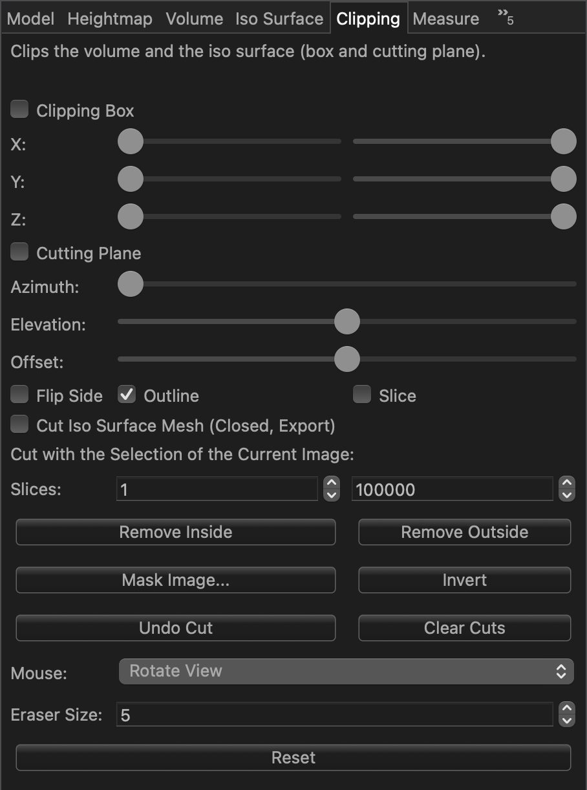

*Figure 4.31 The Clipping tab*

The clipping removes parts of the volume and the iso surface: a **Clipping Box** (x, y, z ranges) and a **Cutting Plane** (Azimuth, Elevation, Offset, **Flip Side** removes the other side). **Outline** draws the outline of the plane, **Slice** displays the cross-section of the plane with the data. **Cut Iso Surface Mesh (Closed, Export)** cuts the mesh with the box and the plane (closed with caps, also for the export).

With the selection of the current ImageJ image the voxels inside or outside can be removed for a range of slices (**Remove Inside**, **Remove Outside**). **Mask Image...** removes the voxels with the value 0 of a binary mask stack. The cuts can be inverted, undone and cleared. With the **Mouse** tool the plane can be dragged in the 3D view or voxels can be removed with an eraser (**Eraser Size**) along the view direction.

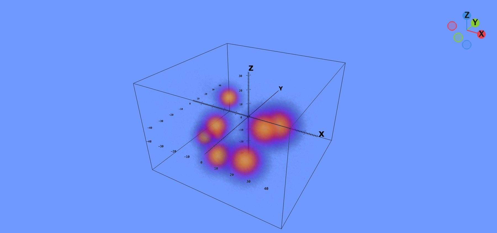

*Figure 4.32 A volume (Fire LUT) cut with the clipping box*

#### 4.4.2.11 Measure

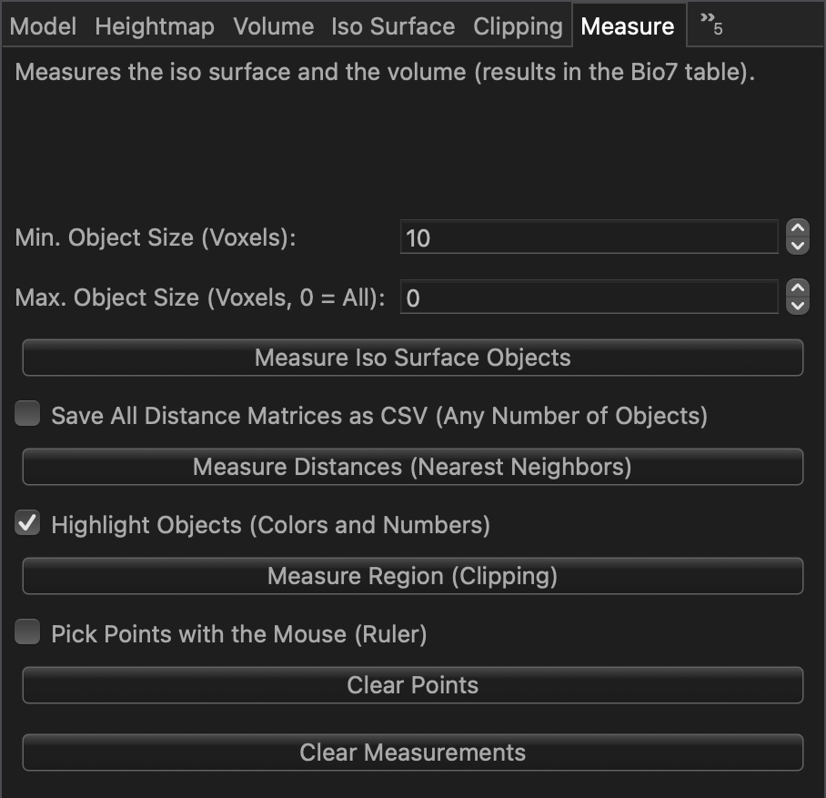

*Figure 4.33 The Measure tab*

The Measure tab measures the iso surface and the volume. The results are displayed in the Bio7 table:

-   **Measure Iso Surface Objects**: the volume, surface area, sphericity, centroid, ellipsoid axes, Feret diameter and holes of the objects of the iso surface (with a minimum and maximum object size in voxels).
-   **Measure Distances (Nearest Neighbors)**: the nearest neighbors of the objects (the centroids and the surfaces edge to edge), the distance matrices and the Clark-Evans index (optional all distance matrices as CSV files).
-   **Highlight Objects (Colors and Numbers)**: colors the measured objects and displays their numbers (the colors and numbers of the table). A click on a number in the 3D view selects the object.
-   **Measure Region (Clipping)**: statistics of the voxels in the region of the clipping (box, plane and cuts) and the volume above the iso value.
-   **Pick Points with the Mouse (Ruler)**: a click on the iso surface or the volume adds a point (position, value and distance) to the table.

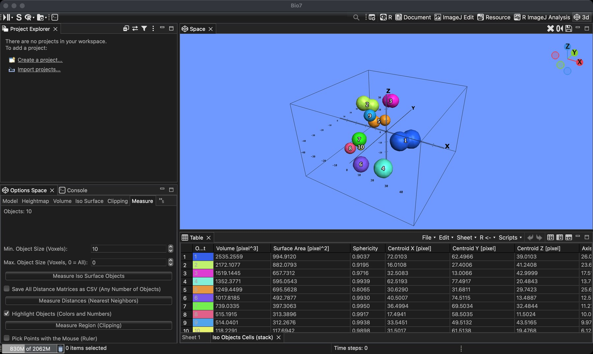

*Figure 4.34 The measured objects of an iso surface with the results in the Bio7 table*

### 4.4.3 The Plot API

The plot API (class Plot3D, package com.eco.bio7.spatial) creates interactive 3D plots in the Space view with a few lines of Java (or Groovy, BeanShell, Jython, etc.). A plot contains one or more layers (e.g., a surface and a scatter plot), the title, the axis titles, the legend and a color bar. The plot is displayed with show() which opens the 3d perspective if necessary.

```java
import com.eco.bio7.spatial.Plot3D;
import com.eco.bio7.spatial.PlotLegend;

int n = 50;
double[] x = new double[n], y = new double[n];
double[][] z = new double[n][n];
for (int i = 0; i < n; i++) {
    x[i] = -3 + 6.0 * i / (n - 1);
    y[i] = x[i];
}
for (int i = 0; i < n; i++)
    for (int j = 0; j < n; j++)
        z[i][j] = Math.sin(x[i]) * Math.cos(y[j]);

new Plot3D().title("Surface").axisTitles("x", "y", "z")
    .add(Plot3D.surface(x, y, z).colorMap(PlotLegend.VIRIDIS))
    .colorBarTitle("z")
    .show();
```

Table 4.3 A surface plot with the plot API

The following layers are available as static factory methods of Plot3D:

| **Method**                                    | **Plot**                                                                     |
|:----------------------------------------------|:-----------------------------------------------------------------------------|
| scatter(x, y, z)                              | A scatter plot (spheres, with values for the colors, a layer for each group) |
| line(x, y, z), filledLine(x, y, z)            | Lines and filled lines (ribbons)                                             |
| surface(x, y, z), wireframe(x, y, z)          | A surface or a wireframe of a grid z\[x\]\[y\]                               |
| contour(x, y, z)                              | Contour lines of a grid                                                      |
| bars(x, y, z)                                 | 3D bars (e.g., a 2D histogram)                                               |
| pie(values, labels)                           | A pie chart                                                                  |
| lineGraph(x, series)                          | Line graphs of several series                                                |
| boxplot(groups, names), violin(groups, names) | Box plots and violin plots of groups                                         |
| histogram(values), histogram(groups, names)   | Histograms                                                                   |
| area(x, series)                               | Stacked areas                                                                |
| radar(series, axes)                           | A radar (spider) chart                                                       |
| rose(values, sectors)                         | A rose chart (e.g., wind directions)                                         |
| treemap(values, labels)                       | A treemap                                                                    |

Table 4.4 The layers of the plot API

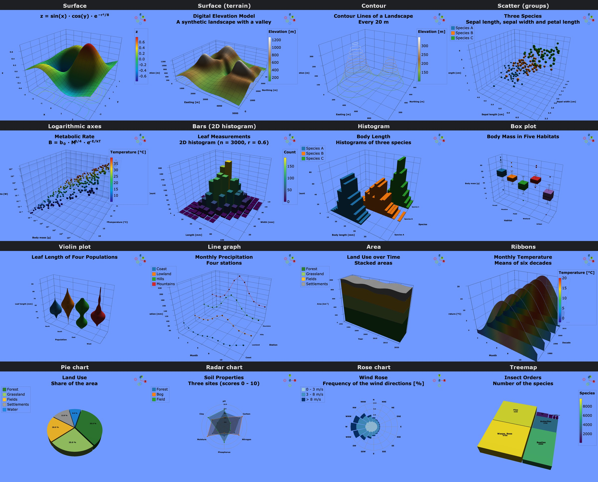

*Figure 4.35 Plots of the plot API (examples of the Bio7 Java examples, opengl/plotapi)*

The settings of a plot are methods of Plot3D: title, axisTitles, logAxes (logarithmic axes), numberFormats, xRange, yRange, zRange, aspect, categories (category labels of an axis), grids, colorBarTitle, legend, textColors and textColor (the colors of the title, the axis numbers, the axis titles and the legend) and fonts and font (the font families of the texts, the installed families are available with Plot3D.availableFonts()).

```java
new Plot3D().title("Fonts of a Plot").axisTitles("Length [cm]", "Width [cm]", "Height")
    .fonts("Georgia", "Courier New", "Times New Roman", "Courier New") // title, numbers, axis titles, legend
    .textColors(0x202020, 0x404040, 0x202020, 0x202020)
    .add(Plot3D.surface(x, y, z).colorMap(PlotLegend.VIRIDIS))
    .show();
```

Table 4.5 Fonts and text colors of a plot

#### 4.4.3.1 Dynamic Plots

A plot can be updated, e.g., in each step of a simulation: the layers are replaced (clearLayers, set, remove, add) and the plot is displayed again with update() (without a reset of the view, the rotation and the zoom are kept). Several examples are available in the folder opengl/plotapi/dynamic of the Bio7 Java examples (e.g., a dynamic scatter plot, histogram, violin plot or rose chart).

```java
Plot3D plot = new Plot3D().title("Random Walk").xRange(-30, 30).yRange(-30, 30).zRange(-30, 30);
plot.show();
for (int t = 0; t < 500; t++) {
    step(); // the model
    plot.clearLayers().add(Plot3D.scatter(x, y, z).values(z)).update();
    Thread.sleep(50);
}
```

Table 4.6 A dynamic plot

#### 4.4.3.2 Plots of the Bio7 Table

With the class PlotTable the data of the Bio7 table can be plotted: PlotTable.select(...) opens a dialog to select the columns of the active sheet (or of the selected cells) for the roles of a plot (e.g., X, Y, Z and an optional group). The dialog contains the settings of the plot, too: the title, the axis titles, logarithmic axes, the color map and the export action. Examples are available in the folder opengl/plotapi/table (the demo data are created with TableDemoData).

```java
PlotTable.Selection s = PlotTable.select("3D Scatter Plot", "Select the columns", "X", "Y", "Z", "Group?");
if (s != null) {
    // The title, the axis titles, the log axes and the export action of the dialog
    s.apply(new Plot3D())
        .add(Plot3D.scatter(s.numbers(0), s.numbers(1), s.numbers(2)).label(s.name(2)))
        .show();
}
```

Table 4.7 A scatter plot of the Bio7 table (see TableScatterPlot for a layer of each group)

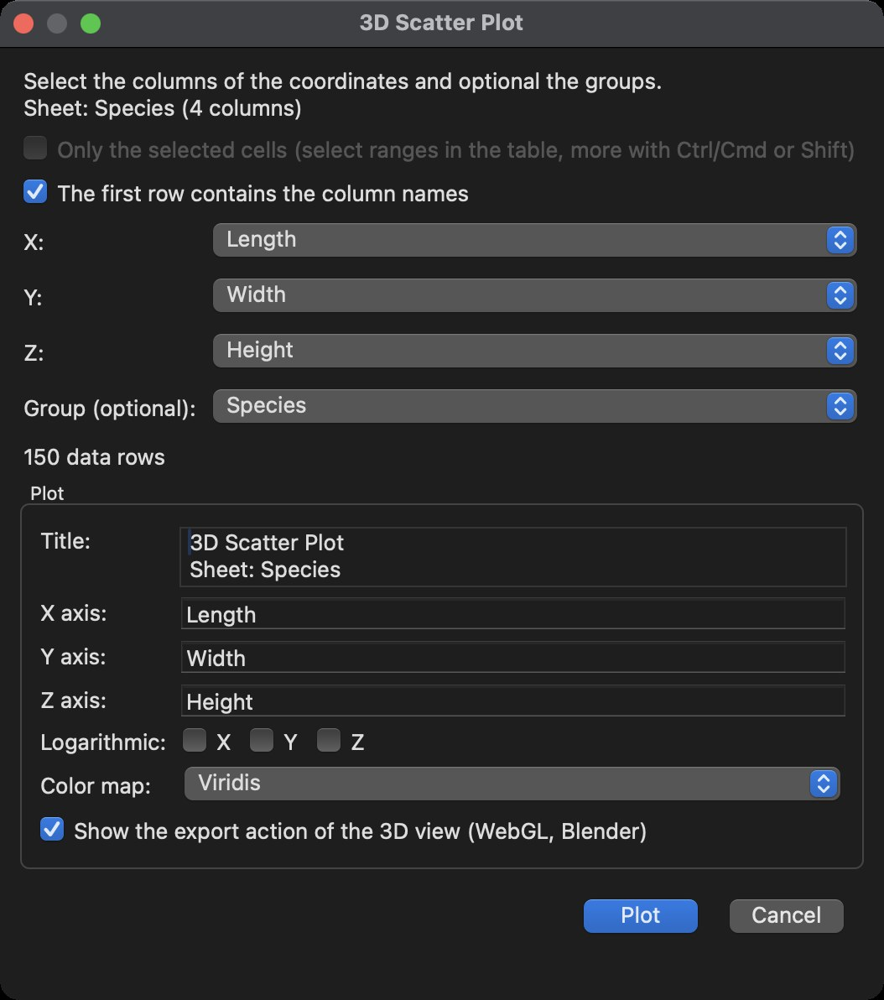

*Figure 4.36 The dialog of the table plot*

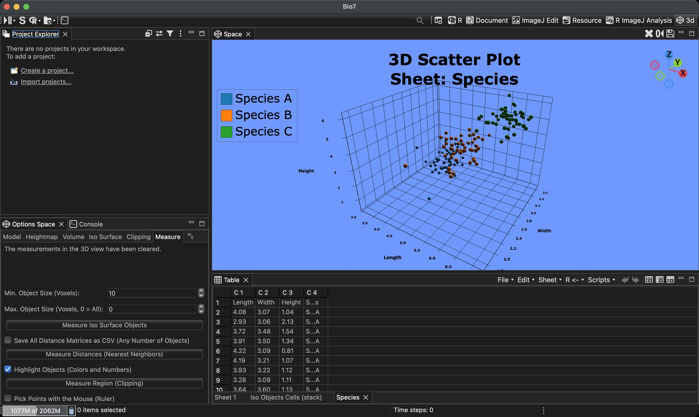

*Figure 4.37 A scatter plot of the Bio7 table with groups*

#### 4.4.3.3 Export of Plots (WebGL, glTF, Blender)

A plot can be exported to an interactive web page (exportHtml, a single HTML file with WebGL, the plot can be rotated and zoomed in any web browser), to a glTF file (exportGltf, \*.glb) and for Blender (exportBlender, a \*.glb file and a Python script which imports the plot with the texts, a camera and lights in a new scene: in Blender Scripting - Open - Run Script). With exportAction(true) the export action is displayed in the toolbar of the Space view (Export Plot (WebGL, Blender)).

```java
Plot3D plot = new Plot3D().title("Digital Elevation Model")
    .add(Plot3D.surface(x, y, z).colorMap(PlotLegend.TERRAIN));
plot.exportHtml("/path/terrain.html");
plot.exportBlender("/path/terrain.glb"); // writes terrain.glb and terrain.py
```

Table 4.8 The export of a plot

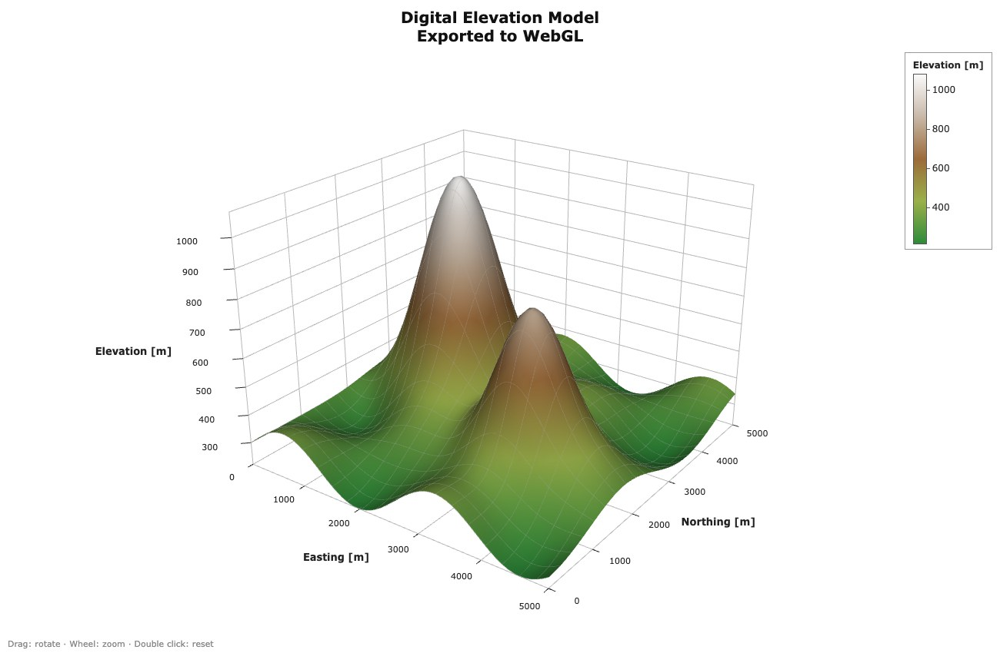

*Figure 4.38 An exported plot in a web browser (WebGL)*

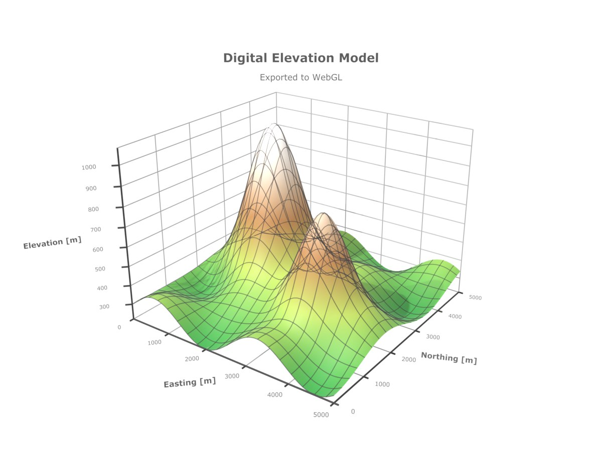

*Figure 4.39 The same plot rendered in Blender*

The Blender script uses the fonts of the plot (the font files of the system) and sets the output folder of a rendered animation next to the \*.glb file.

#### 4.4.3.4 Recording of Plots

With the class PlotRecorder a dynamic plot can be recorded frame by frame and exported to an HTML page with a player (Play/Pause, a timeline, the speed and a loop) or for Blender as an animation (the visibility of the objects is animated in the timeline of Blender, e.g., to render a film).

```java
PlotRecorder recorder = new PlotRecorder().speed(10);
for (int t = 0; t < 100; t++) {
    step(); // the model
    plot.clearLayers().add(Plot3D.scatter(x, y, z)).update();
    recorder.frame(plot);
}
recorder.export("/path/recording.html");
recorder.exportBlender("/path/recording.glb");
```

Table 4.9 The recording of a dynamic plot

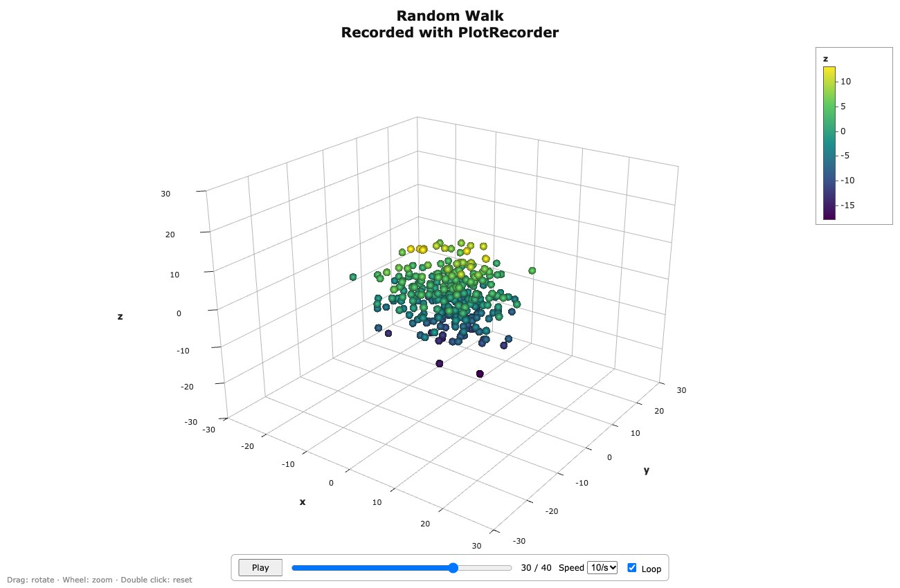

*Figure 4.40 A recorded plot with the player in a web browser*

### 4.4.4 HTML Simulations

The class HtmlSimulation exports an interactive simulation to a single HTML page (without dependencies, WebGL for 3D). The simulation runs in the web browser: the model is written in JavaScript with the functions setup(sim) (called at the start and with Reset) and step(sim) (one time step). The page contains Play/Pause, Step, Reset, the speed, the controls of the settings (sliders, number fields, text fields, check boxes, choices and buttons) and an optional chart of values over time. The settings are available in the model as sim.p.name.

The view of a simulation is a 2D grid (View.GRID\_2D, e.g., a cellular automaton with optional agents), a 3D scene (View.SCENE\_3D, points and lines, e.g., a swarm) or a dynamic surface (View.SURFACE\_3D, e.g., a diffusion).

```java
new HtmlSimulation("Game of Life")
    .view(HtmlSimulation.View.GRID_2D)
    .number("size", "Grid size (cells)", 120)
    .slider("density", "Start density", 0, 1, 0.01, 0.3)
    .restartOn("size", "density")
    .chart("Population")
    .scriptFile("/path/GameOfLife.js") // the model in a JavaScript file
    .export("/path/GameOfLife.html");
```

Table 4.10 An HTML simulation with the model in a JavaScript file

The model can be embedded as a string (code) or loaded from a JavaScript file (scriptFile) which can be edited in an editor of Bio7 (e.g., the generic editor). The export copies the script file next to the page or merges it into one HTML file (embedScript(true)). A template of a script file is created with HtmlSimulation.writeScriptTemplate(file). Several examples are available in the folder html of the Bio7 Java examples (e.g., the Game of Life, an epidemic model, a forest fire, a swarm, a heat diffusion, a reaction-diffusion model and foraging ants).

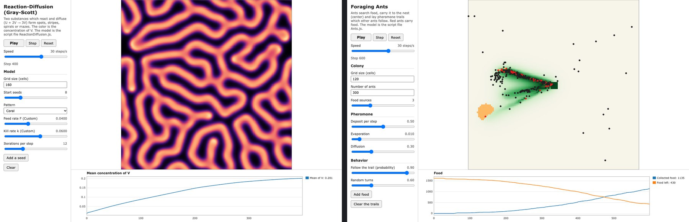

*Figure 4.41 Two HTML simulations with the model in a JavaScript file: a reaction-diffusion model (Gray-Scott) and foraging ants*

### 4.4.5 Fullscreen Mode

The Space view can be displayed in the fullscreen mode with the keys F2 (the primary monitor), F3 (the secondary monitor), F4 (the tertiary monitor) and F5 (a selected monitor). The fullscreen mode is quit with the Escape key (or F2). The switch to the fullscreen mode creates a new OpenGL context and invokes the setup method again, so textures, TextRenderer objects and models of custom code should be created in the setup method.

## 4.5 The WorldWind Perspective

The WorldWind perspective can be opened in the perspective bar (WorldWind). It embeds the **WorldWind** view with the virtual globe of NASA WorldWind Java (https://worldwind.arc.nasa.gov/java/) and the **Options WorldWind** view with the settings of the globe in several tabs (Control, Default Layers, Layers, Render, Measure and Projection). The globe displays satellite images, maps, elevations, boundaries and place names and in addition own data: ImageJ images, GeoTIFF images, shapefiles and custom OpenGL layers (Java).

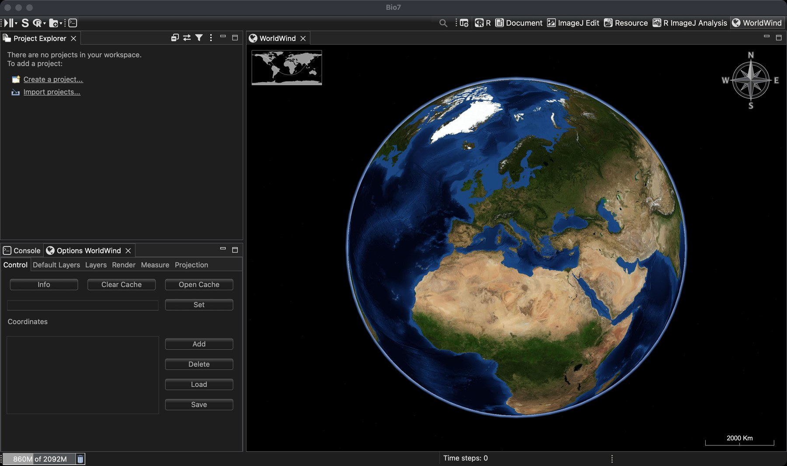

*Figure 4.42 The WorldWind perspective (dark theme)*

The overlays of the globe (the compass, the scale bar, the world map, the view controls, the graticules, the place names, the boundaries and the measure tool) are scaled for high DPI displays (e.g., a Retina display). The compass is drawn with the colors of the active Bio7 theme.

### 4.5.1 The Controls of the Globe

| **Function**    | **Mouse with a scroll wheel**                                              | **Single mouse button**                                                       |
|:----------------|:---------------------------------------------------------------------------|:------------------------------------------------------------------------------|
| Pan             | Left mouse button: click & drag (all directions)                           | Left mouse button: click & drag, click once to center the view                |
| Zoom            | Scroll wheel or left and right mouse button: click & drag up and down      | Ctrl and the left mouse button: click & drag up and down                      |
| Tilt            | Right mouse button: click & drag up and down or PageUp, PageDown           | Shift and the left mouse button: click & drag up and down or PageUp, PageDown |
| Rotate          | Right mouse button: click & drag left and right                            | Shift and the left mouse button: click & drag left and right                  |
| Stop            | Spacebar                                                                   | Spacebar                                                                      |
| Reset heading   | N                                                                          | N                                                                             |
| Reset all       | R                                                                          | R                                                                             |
| Fullscreen      | F2 (primary monitor), F3 (secondary), F4 (tertiary), F5 (selected monitor) | F2, F3, F4, F5                                                                |
| Exit fullscreen | Escape (or F2)                                                             | Escape (or F2)                                                                |

Table 4.11 The controls of the globe (see https://worldwind.arc.nasa.gov/java/)

The fullscreen keys are the same in all views of Bio7 with a fullscreen mode (WorldWind, the 3D view, ImageJ and the custom views).

### 4.5.2 The Options WorldWind View

#### 4.5.2.1 Control

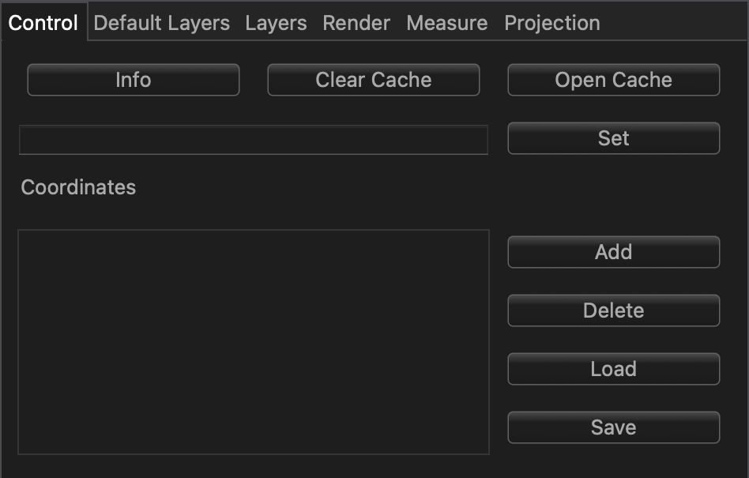

*Figure 4.43 The Control tab*

In the text field of the Control tab coordinates (latitude, longitude) can be entered to fly to a location (**Set**). The coordinates of the current view can be stored in the list of locations (**Add**) and visited again with a double-click on a list entry, e.g., for a presentation in the fullscreen mode. Selected locations can be deleted (**Delete**), the list can be saved and loaded as a \*.txt file (**Save**, **Load**). **Clear Cache** deletes the downloaded images and elevations (the tiles of the layers), **Open Cache** opens the location of the cache.

#### 4.5.2.2 Default Layers

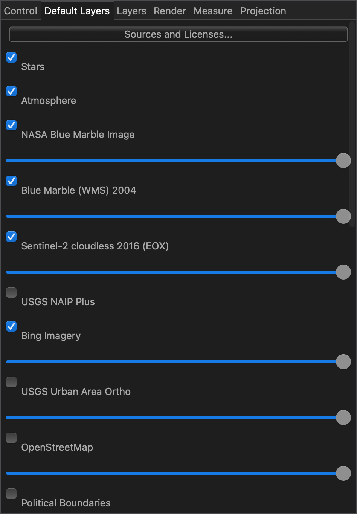

*Figure 4.44 The Default Layers tab*

The Default Layers tab enables and disables the layers of the globe and blends them with an opacity (the sliders). Some layers are enabled by default, other layers can be enabled when needed:

-   **Stars**, **Atmosphere** and the **NASA Blue Marble Image** (included in WorldWind, also available offline).
-   **Blue Marble (WMS) 2004** (NASA GIBS) and **Sentinel-2 cloudless 2016** (EOX, Copernicus Sentinel data): satellite images of the earth.
-   **Bing Imagery**, **USGS NAIP Plus** and **USGS Urban Area Ortho**: high resolution aerial images (partly only for the USA).
-   **OpenStreetMap**: the standard map of OpenStreetMap as sharp tiles (also on high DPI displays), see the figure below.
-   **Political Boundaries** and **Place Names**: the boundaries of the countries and the populated places of Natural Earth (public domain, bundled with Bio7, drawn as vectors and text). More place names are displayed when the view is closer.
-   **View Controls**, **Lat-Lon Graticule**, **MGRS Graticule**, **World Map**, **Scale bar** and **Compass**.

The data of the layers have to be cited, e.g., if a screenshot of the globe is published. **Sources and Licenses...** opens a dialog with the sources, the licenses and the links of the enabled layers (the source of a layer is shown as the tooltip of the layer, too).


*Figure 4.45 The political boundaries and the place names of Natural Earth over the satellite images*


*Figure 4.46 The OpenStreetMap layer (© OpenStreetMap contributors) on the tilted globe*


*Figure 4.47 The sources and licenses of the layers*

#### 4.5.2.3 Layers


*Figure 4.48 The Layers tab*

With the Layers tab own data can be displayed on the globe: GeoTIFF images (**Add GeoTIFF**), shapefiles (**Add Shapefile**), the active ImageJ image as a static layer (**IJ image**) or as a dynamic layer which is updated with the image (**IJ Dynamic**, e.g., an animated stack) and a custom OpenGL layer of compiled Java code (**Dyn. Layer**). An added layer gets its own panel with the controls of the layer (e.g., the opacity and the removal of the layer).

The **Latitude** and **Longitude** fields define the area of an image on the globe (the minimum and maximum), **Go to** flies to the area. **Get Area** fills the fields with the values of special variables in R (e.g., an area which is georeferenced in R), with **Compute** the corners of an area can be picked on the globe (alternately the minimum and the maximum, disable the toggle after the selection). **Image Alpha** makes a color of an image transparent. So, e.g., an R plot (ImageJ is the default plot device of R in Bio7) can be positioned on the globe.

#### 4.5.2.4 Render


*Figure 4.49 The Render tab*

**Capture** renders the globe to an ImageJ stack (the number of **Frames** and the frame rate **FPS** can be adjusted), e.g., to save an animation of a flight over the globe. **Screenshot** transfers the current view as an image to ImageJ. **Info** shows a short help for the two actions.

#### 4.5.2.5 Measure


*Figure 4.50 The Measure tab*

In the Measure tab distances, areas and shapes can be measured on the globe. Before a measurement the **Shape** (a line, a path, a polygon, a circle, an ellipse, a square or a rectangle), the **Path type**, the **Units** and the **Angle Format** can be selected. **Follow terrain** includes the heights of the terrain, the **Control points**, the **Rubber band**, a **Free Hand** selection and the **Tooltip** can be enabled. A measurement is started with **New Measur.**, edited with **Edit** and stopped with **End**. The colors of the line, the points and the tooltip can be changed. The results (length, area, width, height, heading and center) are displayed in the table and can be transferred to R (**Values-&gt;R**).

#### 4.5.2.6 Projection


*Figure 4.51 The Projection tab*

**Flat** displays the globe as a flat map with the selected projection (Lat-Lon, Mercator, Sinusoidal or modified Sinusoidal).


*Figure 4.52 The flat projection of the globe (Lat-Lon)*

## 4.6 The R Perspective and Menus

Bio7 embeds R for the statistical analysis of data, images and models. R is connected with **Rserve**: **R &gt; Start Rserve** starts R in the Bio7 console and the Rserve server in this R session (cooperative mode on Linux and macOS), then Bio7 connects to the server (displayed in the progress dialog and in the console). After the connection has been established R can be used in the R-Shell view, the R editor, the Table view, the ImageJ views and with the scripts and the compiler of Bio7. The path to R, the R startup arguments, the Rserve startup arguments (e.g., a port) and the client port are set in the R preferences (see <a href="README.md#46213-rserve-preferences" class="Reference">4.6.2.13↓</a>).

### 4.6.1 R Menus in the Bio7 Main Menu

-   **Start Rserve:** Starts R with an Rserve connection (or stops the connection).
-   **Load Workspace, Save Workspace:** Loads or saves an R workspace (\*.RData).
-   **Evaluate Expression:** Opens a dialog to evaluate an R expression, the result is displayed in the console.
-   **Evaluate Line or Selection:** Evaluates the selected text or the current line of the R editor and moves to the next line. A line is only evaluated if the expression is complete, else it is collected until the expression is complete (interrupt with the action of the R-Shell view).
-   **Evaluate Clipboard:** Evaluates the R script in the clipboard.
-   **Get Clipboard Data:** Transfers the data of the clipboard (e.g., cells of a spreadsheet) to the R workspace as the dataframe clip.
-   **Remove All Objects:** Removes all objects of the current workspace.
-   **Start RGui with Workspace:** Windows: starts RGui with the current workspace.

### 4.6.2 The R Perspective

The R perspective contains the views for the work with R: the **R-Shell** view (expressions and the objects of the workspace), the **Packages** view, the **Database** view and the Project Explorer at the top left, the **Console** (R), the **Plot** view and the **R Snippets** at the bottom left, the editor area (e.g., the R editor), the **Table** view and the Snippets view below and the Outline at the right.


*Figure 4.53 The R perspective with objects of the R workspace and a dataframe in the Table view (dark theme)*

#### 4.6.2.1 The Table View

The Table view is a spreadsheet in which data can be imported, exported, edited and transferred to and from R. Several sheets can be opened side by side. A selection (also several ranges with Ctrl/Cmd or Shift) is highlighted with the accent color of the theme, a click on a column or row header selects the column or the row. Every sheet has its own undo and redo (the arrows in the toolbar of the view). The toolbar adds columns, rows and sheets.


*Figure 4.54 The Table view with a selection and the menus of the view*

-   **File:** Import: CSV, Excel (97-2003 and 2007-2013 XML), OpenOffice and Bio7 XML (formatted sheets with images). Export: Excel (97-2003 and 2007-2013 XML), OpenOffice, Text and Bio7 XML.
-   **Edit:** Cut, copy, paste and delete (Ctrl/Cmd+X, C, V, Del), copy an image to the clipboard and paste an image from the clipboard, the background color, the gridline color, the font and the size of the selected cells.
-   **Sheet:** Add a sheet (or a sheet with a size), rename a sheet (or a double-click on the tab), add rows and columns (before or after the selection) and remove the selected rows or columns.
-   **R &lt;-:** Transfers the sheet to R as a dataframe (R&lt;-Table, with the first row as names: R&lt;- Table+head) or the selection as a numeric, factor or character vector.
-   **Scripts:** Custom Groovy, BeanShell, Jython or R scripts (see <a href="README.md#104-install-eclipse-r-imagej-plugins-or-packages-in-bio7" class="Reference">10.4↓</a>).

The data of a sheet can also be plotted in the 3D view with the plot API (a dialog selects the columns, see <a href="README.md#443-the-plot-api" class="Reference">4.4.3↑</a>).

#### 4.6.2.2 File Import for CSV Data

**File &gt; Import CSV** of the Table view opens the CSV Reader. A file (**File**) or the text of the clipboard (**From clipboard**) is imported with the options of the dialog; the preview shows the result of the options immediately and a message shows problems (e.g., a missing separator):

-   **Separator character**: comma, semicolon, tab or another character. **Detect** finds the separator (comma, semicolon, tab or pipe) from the first lines.
-   **Quote character**, **Escape character** and **Comment character** (lines starting with this character are skipped).
-   **Start at line** and the **Encoding** of the file.
-   **Strict Quotes**, **Ignore Quotations**, **Ignore Leading WS** (leading whitespace), **Trim Values**, **Keep CR** (carriage returns), **Skip Empty Rows** and **Column Titles** (the first row contains the names of the columns).


*Figure 4.55 The CSV Reader with the preview*

#### 4.6.2.3 The R-Shell View

The R-Shell view contains an expression field, the actions of the expressions, the list of the objects of the R workspace and the description of a selected object.


*Figure 4.56 The R-Shell view (maximized) with the objects of the workspace*

The Expression Field

In the expression field R expressions are parsed and evaluated (Enter). Parse errors are indicated, the code completion opens with Ctrl+Space and the history of the expressions opens with the Arrow Up key (a click transfers an expression to the field). The actions below the field:

-   **Eval:** Evaluates the expression (several expressions are separated with a semicolon).
-   **Load, Save:** Imports data to R or loads the history, exports R data or saves the history (up to 100 expressions).
-   **R Doc:** Opens the documentation of R.
-   **?:** Opens the help of the keyword in the field (a function, a package, etc.).
-   **Interrupt:** The last button interrupts the R execution.

| **Keys (macOS: Cmd instead of Ctrl)** | **Function**                                                                     |
|:--------------------------------------|:---------------------------------------------------------------------------------|
| Ctrl+Space                            | Code completion                                                                  |
| Arrow Up                              | The history of the expressions                                                   |
| Ctrl+Enter                            | Writes the expression into the R editor (or R Markdown editor) with a line break |
| Alt+Shift+- (macOS: Cmd+Alt+Shift+B)  | Inserts the assignment &lt;-                                                     |
| Alt+Shift+N (macOS: Cmd+Alt+Shift+N)  | Inserts the pipe %&gt;%                                                          |
| Ctrl+Alt+Shift+O, Ctrl+Alt+Shift+S    | Inserts the code to open or save a file (selected in a dialog)                   |
| Ctrl+Alt+Shift+I                      | Writes the history into the R editor                                             |
| Ctrl+Alt+Shift+R                      | Reloads the code completion (e.g., after a package has been loaded)              |

Table 4.12 The keys of the expression field

The Objects of the Workspace

The list shows the objects of the R workspace. A selected object is described in the panel at the right (type, class and size). The actions:

-   **List:** Updates the list of the objects (ls()).
-   **Del:** Removes the selected objects (several with Ctrl/Cmd or Shift).
-   **Gc:** Starts the garbage collection of R.
-   **Clear:** Clears the description panel.
-   **Font:** Changes the font of the list and the description.
-   **?:** Shows the help of the actions.

The key **A** transfers the selected object names to the expression field separated by commas, the key **C** separated by plus characters (e.g., for a formula).

Context Menu of the Objects

-   **Show, Summary:** Prints the values or the summary of the selected object in the console.
-   **Filter:** Shows only objects of a kind: Dataframes, Matrices, Vectors, Functions, etc.
-   **Convert:** Converts the selected object To Character, To Dataframe, To Factor, To List of Objects, To Matrix, To Numeric or To Vector.
-   **Transfer to Table:** Transfers the object to the Table view: Dataframe with Head (a new sheet with the names in the first row), Dataframe, Matrix, Vector to Rows and Vector to Columns (from the selected cell of the active sheet).
-   **LibreOffice:** Opens a LibreOffice spreadsheet and transfers data between R and LibreOffice (Data to R, Data with Head to R).
-   **Scripts:** Custom scripts in special folders extend the context menu (see <a href="README.md#104-install-eclipse-r-imagej-plugins-or-packages-in-bio7" class="Reference">10.4↓</a>).

#### 4.6.2.4 The R Snippets View


*Figure 4.57 The R Snippets view*

The R Snippets view offers templates in thematic tabs (Variables, Data, Math, Statistics, Image, Matrix, Spatial Statistics, ...). A selected template shows its description. A double-click transfers the template to the expression field of the R-Shell view, a double-click with the right mouse button transfers it to an opened R editor.

#### 4.6.2.5 The Packages view

The Install Packages tab

The packages view consists of three tabs to install, load and manage R packages. In the **Install Packages** tab a package list can be loaded from the default R mirror (see <a href="README.md#46213-rserve-preferences" class="Reference">4.6.2.13↓</a>) with the **Load Packages list** action and installed with the **Install Selected** action. If something went wrong with the installation it can make sense to start Rserve in a OS shell to get more information about the installation process (see <a href="README.md#46213-rserve-preferences" class="Reference">4.6.2.13↓</a>). To find the right R package some search facilities are available to find the package in the package list and to get some information about the package (select the **Open Package Description** option). With the **Update Installed Packages** action all currently installed R packages (except the Rserve package) will be updated if possible.


*Figure 4.58 The Install Packages tab*

The Load Packages tab

The **Load Packages** tab displays the currently installed R packages and their version numbers. This list can be refreshed with the **Refresh Packages List** action (a refresh of the list also occurs when the tab is switched!). A **double-click** on the list with the mouse loads the selected package which in turn also reloads the package code completion list for the R-Shell and the R editor. With the **Remove Selected Package** action a R package can be removed. With the **Add selected to R editor** action selected libraries can be added to an opened R editor as text (library(xxx)). With the Update selected Package action selected packages can be updated if an update is available. With the option Open Package Description a browser will be opened to display the current selected package information.


*Figure 4.59 The Load Packages tab*

The Attached Packages tab

The **Attached Packages** tab displays the current loaded R packages. With the **Refresh** **Packages List** action this list can be updated (a refresh of the list also occurs when the tab is switched!). A context menu is available with an **Detach** action to detach a selected package and a **Refresh** packages list action.


*Figure 4.60 The Attached Packages tab*

#### 4.6.2.6 The Plot Data View

A selected data structure (in the data view of the Object tab) can be plotted easily with the different plot actions in this view. The selected plot type has to be appropriate for the selected datatype. Default all plots are created as an Image in ImageJ. If the option **Detour** is enabled all commands are transferred to the textfield for customization (templates are available in the context menu of the textfield). The customized command then can be plotted with the **Draw Plot** action.


*Figure 4.61 The Plot Data view with context menu*

#### 4.6.2.7 The R Editor


*Figure 4.62 The R editor with the opened context menu*

The R editor of Bio7 supports the syntax of the R language. If an R file is created with the default wizard the extension of the created R script file is \*r. If you have an \*.r file outside the workbench, this file can simply be dropped to a project of Bio7. If a R file has been opened, the toolbar of the Bio7 application displays a new action item for the interpretation of R scripts (if a connection to the Rserver and R has been established).

R editor parser

The R editor of Bio7 is connected to an R parser. Each time the R code in the editor is changed the editor file is parsed and error or warning markers are created - visible as icons in the vertical ruler and underlined in the text where the errors or warnings have been detected. In addition the R parser creates code analytics to detect and inform about several flaws in the code. If some code assistence is available a light bulb will be displayed in the vertical ruler of the editor. A click on the quick fix icon opens a code suggestion which can be applied with a mouse click. The error and warning messages can also also opened if the underlined marked word is hovered. Hovered quick fixes can be confirmed with a mouse click, too.


*Figure 4.63 The R editor with errors and warnings. Error and warning quick fixes are indicated with a light bulb icon. Quick fixes can be opened (and applied) when hovering over the underlined error or warning.*

#### 4.6.2.8 The Database View

The database view contains three tabs to configure a database connection. For a database connection the ODBC drivers have to be installed for the dedicated Operating System. The R packages **odbc** and **DBI** have to be installed, too. In the first tab **Connection** some templates are available which can be selected to be used for a custom connection and displays the connection information of the **Database** and **SSH Tunnel** tab.

To start with a custom connection:

1.  Install the ODBC drivers and R packages (**odbc**, **DBI**)
2.  Select one available default profile
3.  Update the login data on the **Database** and (if enabled) **SSH Tunnel** tab. In additon customize the **Custom Disconnect Code** for a live connection. Please note if no database password should be stored for the database connection leave the password field blank. For each live database connection a password dialog will be opened to ask for the username and password (handy if you don’t want to store the database password or the password should be hidden in a public area)
4.  Store the current profile with the **Add Connection Profile** action
5.  Use the **Connect** action to establish a database connection
6.  Use the **Disconnect** action to execute the R code given in the **Custom Disconnect Code** textfield

In the following section the different tabs and settings are described in detail.

The Connection Tab Settings

-   The **Add Connection Profile** action stores the current settings of the Database and SSH (if enabled) entries in a new profile and adds the selected name to the list of available **Stored Profiles** (saved as a XML file in Bio7).
-   The **Delete Stored Profile** action deletes the current selected profile and removes the profile from the **Stored Profiles** list.
-   The **Use SSH Tunnel** option adds the settings of the SSH Tunnel tab to the database tab settings which will be previewed in the **Preview** textfield.
-   The **Preview** textfield shows the current settings of the database and SSH connection which can be stored as a database profile.
-   The **Insert in Editor** action transfers the database connection code to the current opened editor.
-   The **Connect** action establish a connection with the credentials given from the Database and SSH Tunnel tab. The connection is stored in the variable **con**
-   The **Disconnect** action executes R code given in the textfield **Custom Disconnect Code** (available to control the SSH connection!)


*Figure 4.64 The Connection tab*

The Database Tab Settings

1.  The **List ODBC Drivers** action searches for available ODBC drivers on the OS and add them to the **ODBC Driver** list
2.  The **ODBC Driver** list let you select a ODBC driver for a database connection by name found by the action **List ODBC Drivers**
3.  The **Server** textfield to enter the server address of the database
4.  The **Database** textfield to enter the database name of the connection
5.  The **Port** to enter the port of the database
6.  The **User** textfield to enter the username.If empty a login dialog will automatically be opened for the username and password
7.  The **Password** textfield to enter the password of the database connection. If empty a login dialog will automatically be opened to enter the username and password


*Figure 4.65 The Database tab*

The SSH Tunnel Tab Settings

1.  The **SSH Host** textfield and **Port** spinner for the server address and port of the SSH connection
2.  The **Username** of the SSH connection (password should be stored in the SSH key!)
3.  The **Sleep** spinner to execute the sleep command on the remote server (default to 10s)
4.  The **Private Key file** textfield and file dialog action to set the location of the private SSH key
5.  The **Local Port** to set the port for port forwarding (This setting lets you specify a local port that will be forwarded to your remote host and remote port)
6.  The **Custom arguments** textfield to change or add custom SSH client options


*Figure 4.66 The SSH Tunnel tab*

#### 4.6.2.9 Plotting

Since Bio7 1.7.1 it is possible to plot single and multiple plots with ImageJ as the default R plot device. Multiple plots are displayed in an ImageJ image stack (with the available slider you can select one plot in the stack). Plots and plot stacks can be saved as images and movies with ImageJ in different formats (e.g. stacks can be stored as \*.avi or animated \*.gif). The size of the plots and the format can be changed in the Rserve Plot Preferences of Bio7 (see <a href="README.md#46211-r-plot-preferences" class="Reference">4.6.2.11↓</a>) .


*Figure 4.67 A R Plot opened in ImageJ as the default device*

#### 4.6.2.10 R Debugging Interface

Since Bio7 2.0 a debugging GUI for R is integrated as part of the R editor. To debug a R script a breakpoint has to be set inside a R function. If a breakpoint is set several actions are added to the default Bio7 console. For the debugging process the native R console has to be started (The Rserve connection will be automatically change to the native mode if alive!). To start a debugging process the “Debug Trace Action” has to be invoked and the traced function has to be executed in the R shell (see screenshot below). In the shell several debugging actions are available:

1.  The **Debug Trace Action** to start the debugging process.
2.  The **Stop** action to stop the debugging process.
3.  The **Next** action to go to the next statement.
4.  The **Continue** action which continues with the execution without single stepping.
5.  The **Step Into** action to step into function calls.
6.  The **Finish** action to finish the current loop or function.
7.  A **Help** action to display R debugging console commands.


*Figure 4.68 R debugging perspective with debugging toolbar actions enabled.*

R Debugging Perspective and Views

To inspect the current variables a **Debug perspective with a Debug(x)** view is available to display the environment variables and objects. Single variables can be changed in the spreadsheet (“Value” column) to inspect the effect on the environment. In addition a **Debug Text** view is availabe to display external R source not displayed in the opened R file (e.g. if stepped in an package function call).

Debug Context Menu

The context menu offers several actions to:

1.  Set a breakpoint.
2.  Set a conditional breakpoint - Syntax e.g. : *if (x==5) browser()* which is a wrapper for: *trace(fun, quote(if (x == 5) browser())).*
3.  Edit a conditional breakpoint.
4.  Delete a selected breakpoint.
5.  Delete all breakpoints.

#### 4.6.2.11 R Plot Preferences


*Figure 4.69 Rserve preferences to select and adjust the R plot device*

In the preferences several options are available to adjust the R plots. The default plot size can be changed in the textfield **Device Definition** (or the whole plot definition). Beside the option to plot images in ImageJ it is possible to open plots in different applications. Some templates in the preferences can be selected to switch e.g. to a \*.pdf (multiple plots can be displayed) or \*.svg plot (displaying a single plot) which will be opened with the default registered software if available – for \*.svg i recommend <http://www.inkscape.org> to improve the plot appearance). Antialiased image plots can be enabled with the **Image Cairo** option. To change the default **Device Definition** in the textfield press the action **Apply**. With the **Special image plot options** plots can be opened in individual image tabs or macros can be excuted after image creation (handy if you automatically want to scale images after plot creation). Please note that the preferences will be saved if you press the **OK** or **Apply** button.

Special Plot Function

RGL (a special package for 3D plots) and some native windows need a GUI thread which is not available. To trigger a repaint with Bio7 please select the Bio7 window and press the key combination **ALT+A.** This is not necessary if you simply switch to the R native mode!

#### 4.6.2.12 Help

As noted earlier if a command has been typed in the textfield of the R-Shell view and the **?** button has been pressed the action tries to open the default help page for the command in the Bio7 browser (same as typing ?+command in R).


*Figure 4.70 The Help Browser*

#### 4.6.2.13 Rserve preferences

There are several Rserve preferences available wich are described in this section.The following preferences can be adjusted:


*Figure 4.71 Main Rserve preferences*

(1) **General**

-   The path to the R install location.
-   The default package install location.
-   The **Path to temporary R folder** options sets the path to the Bio7 R temp folder. In the temp. folder some plot images and R files are temporarily stored.
-   The **Install path at startup** option installs a registry path to R in the Windows registry (deprecated).
-   The option **Check at startup for running R process(es)** warns for running R processes which can interfer a newly started R/Rserve native process.
-   The **Rserve startup arguments** can be adjusted to start Rserve with custom arguments.
-   The **R startup arguments** can be adjusted to start R with arguments when started together with Rserve.
-   The **Rserve TCP client port** option configures the running Rserve client port of the rserve application.

(2) In the **Packages** preferences you can select the default R package mirror to download R packages from. In addition you can set the install location of the packages.

(3) In the **Transfer to Table options** the transfer method to the Bio7 Table from R can be specified to adjust the numerical precision of numbers. Please consult the R documentation for the command **format**.

(4) The option **R-Shell:...** enables the automatic code completion of the R-Shell view (restart of Bio7 necessary!).

#### 4.6.2.14 R Editor

For a description of the R editor see <a href="README.md#4627-the-r-editor" class="Reference">4.6.2.7↑</a>.

#### 4.6.2.15 Native R Excution

In Bio7 it is possible to execute R scripts and R commands without Rserve (<a href="README.md#101-native-preferences" class="Reference">10.1↓</a>). In the Bio7 console an independant R console can be started which pipes commands directly to an instance of R. If the editor should be used with the native communication this has to be selected in the R preferences of Bio7. Some commands and GUI interfaces cannot be used if the native execution is selected

#### 4.6.2.16 Create R Packages

If R files are selected in the Project Explorer an action is available which opens a dialog to create a R package skeleton from files or selected R workspace variables. After the creation if the created R package folder is selected several available actions help in the build process of a package.

-   **Build PDF From .Rd** to create PDF documentation of \*.Rd files.
-   **Check R Package** - To check if the package is properly configured.
-   **Build R Package** - to start the build process of the package
-   **Install R Package** - to install the R package.


*Figure 4.72 Dialog to create R package skeleton*

#### 4.6.2.17 Create R Packages with the devtools package.

Since Bio7 2.5 a new way of creating packages have been added to the context menu of the Project Explorer by using the devtools library (<https://github.com/hadley/devtools>) to create, test, compile and distribute a new R package. To setup a new R package create a project folder in the workspace of Bio7 and then select the folder and execute the “setup” action in the context menu of the Project Explorer. Documentation will be created if roxygen comments have been added to the R scripts by executing the “Document” action.

-   **Setup** - Setup R package in (project) folder (devtools)
-   **Load All** - Simulates installing and reloading (devtools)
-   **Document** - Updates the documentation, etc. (devtools)
-   **Test** - Tests the packages (devtools)
-   **Install** - Installs the packages
-   **Build** - Builds the packages
-   **Check** - Checks the packages
-   **Build Windows** - Builds the package on Windows
-   **Run Examples** - Runs all examples of the package
-   **Check Manuals** - Checks all manuals
-   **Release** - Releases the package

For some of the listed actions above the OS pseudo terminal in the console view has to be activated or will be activated. Custom flags can be added in the **R Preferences Built Tools** of Bio7. Please note: For the built process of R package binaries some extra tools are needed (especially for Windows). Please consult the R instructions (<http://cran.r-project.org/doc/manuals/R-exts.html>) on the internet or search for available tutorials. For tests on the Windows OS I installed a Latex environment (MiKeTeX with inconsolata.sty style file installed) and the Rtools distribution for Windows (<http://cran.r-project.org/bin/windows/Rtools/)>.

## 4.7 Document Perspective

A special document perspective is available which opens a rendered document (HTML, PDF, etc.) side by side with a Bio7 editor (e.g., markdown, latex, HTML). The editor in this perpspective is shown by default.

## 4.8 The HTML (Web) Perspective

The HTML perspective (**Web** in the perspective bar) is a perspective to create websites and HTML documents: the Project Explorer (left), the editor area and the **Browser** view below the editor to display the result. Bio7 opens \*.html files by default in a simple HTML editor (a source page and a rich text page). The former JavaFX GUI editor for HTML documents is not available anymore.

For a full editor for HTML, CSS, JavaScript, TypeScript, JSON, YAML and XML (syntax highlighting, code completion, validation, formatting, color previews, etc.) it is recommended to install the **Eclipse Wild Web Developer** with the Update Manager of Bio7 from the update site https://download.eclipse.org/wildwebdeveloper/releases/latest/ (see <a href="README.md#8-update-manager" class="Reference">8↓</a>). After the installation an \*.html file is opened with **Open With &gt; Generic Code Editor** in the editor of the Wild Web Developer (it can also be set as the default editor of \*.html files in the preferences: General &gt; Editors &gt; File Associations).


*Figure 4.73 The Web perspective with an HTML file in the editor of the Eclipse Wild Web Developer and the Browser view*

## 4.9 Custom Perspective, Views and Menus

Bio7 can be extended with own user interfaces in **custom views** and with a **custom perspective** (**Custom** in the perspective bar) for special tasks. In addition all views of the application can be used to lay out the custom perspective.

### 4.9.1 Custom Views

A custom view (class CustomView, package com.eco.bio7.collection) embeds an own user interface in Bio7: SWT widgets, Draw2d figures, Swing (JPanel) and AWT panels. Several custom views can be created, each view has a unique id (the secondary id of the view) and is displayed in a tab with a title. The content of a custom view can be displayed in the fullscreen mode (F2 the primary monitor, F3 the secondary, F4 the tertiary, F5 a selected monitor, Escape exits).

```java
import com.eco.bio7.collection.CustomView;
import org.eclipse.swt.SWT;
import org.eclipse.swt.layout.FillLayout;
import org.eclipse.swt.widgets.*;

CustomView view = new CustomView("Control Panel");
Display.getDefault().syncExec(() -> {
    Composite parent = view.getComposite("panel1");
    parent.setLayout(new FillLayout());
    Button button = new Button(parent, SWT.PUSH);
    button.setText("Start");
    parent.layout();
});
```

Table 4.13 A custom view with an SWT button

With getDraw2d(id) a Draw2d LightweightSystem is returned (e.g., for the gauges of the Nebula visualization widgets), with setPanel(jpanel, id) a Swing panel is embedded. Further classes extend the custom views:

-   DetachableCustomView: a custom view which is opened as a detached window, optionally on a selected monitor (MonitorChooser).
-   DetachedControlPanel: a floating control panel (a top-level window) which stays visible in all perspectives, e.g., for the controls of a simulation.
-   Work.moveViewToPanel(customView, viewId, panel, title): moves a view of Bio7 (e.g., the Console) into a panel of a custom view.
-   Work.openPerspective(id), Work.closePerspective(idOrName), Work.openView(id) and Work.closeView(id) open and close perspectives and views from a script.

### 4.9.2 The Custom Perspective

The custom perspective (id com.eco.bio7.CustomPerspective) provides places for custom views: a custom view with one of the secondary ids **left**, **right**, **subLeftTop**, **subLeftBottom**, **subRightTop**, **subRightBottom**, **subRightBottomLeft** or **subRightBottomRight** is placed at this position of the perspective (e.g., left and right are the two halves, the sub ids divide them further). So a complete user interface, e.g., a dashboard of a model or a measurement, can be created with a script. Examples are available in the folder gui of the Bio7 Java examples (e.g., Gauges\_4\_Views, Gauges\_8\_Views, FourQuadrantExample and StationsDashboardExample).

```java
Work.openPerspective("com.eco.bio7.CustomPerspective");
CustomView view = new CustomView("Speed");
LightweightSystem lws = view.getDraw2d("left"); // the left half of the perspective
GaugeFigure gauge = new GaugeFigure();
gauge.setRange(0, 220);
lws.setContents(gauge);
```

Table 4.14 A custom view with a gauge in the custom perspective


*Figure 4.74 The custom perspective with eight custom views (Gauges\_8\_Views example)*


*Figure 4.75 A dashboard of custom views (StationsDashboardExample)*

### 4.9.3 Custom Menus

Another nice feature of Bio7 is the simple way to extend the Script menus in Bio7 with BeanShell, Groovy, Jython scripts, R scripts and ImageJ macros. Bio7 recognizes files dropped to special folders automatically and extends the menus with the filename of the dropped files. for an overview see (see <a href="README.md#104-install-eclipse-r-imagej-plugins-or-packages-in-bio7" class="Reference">10.4↓</a>.

### 4.9.4 Custom Startup

Groovy scripts can be used to customize the platform directly behind the start of the Bio7 application. These scripts will be executed with the Groovy interpreter. The scripts have to be placed in a specialized folder (<a href="README.md#104-install-eclipse-r-imagej-plugins-or-packages-in-bio7" class="Reference">10.4↓</a>) for custom activities like :

-   BeanShell, Groovy, Jython, R, JavaScript, ImageJ customizations or imports at startup.
-   Open or close a custom perspective or a view.
-   Execute a startup setup in the different panels.
-   Invoke an action from the Bio7 platform.
-   Import libraries.
-   Start a server application at startup.

[↑ Contents](#contents)

---

# 5 The Editors of Bio7

## 5.1 General Features

There are several editors integrated in Bio7 which support the syntax of different programming languages and a specialized Flow editor to drop files from the other editors for execution. The "language" editors support the syntax of the languages Java, BeanShell,Groovy, Jython and R. A text editor is also offered by default integrated in the platform (an editor for arbitrary files as well!). All editors if opened offer more or less customized menus and toolbars and also offer custom context menus for the work with the different languages. By activating a language editor, typical text tools are activated in the edit menu of the main menubar of the Bio7 application. Some creation notes are listed below.

-   Before creating a file, a **Project** has to be created where the files can be placed (**File ▷ New ▷ General ▷ Project**).
-   A file can be created by using a wizard, which can be activated in the **File** menu. (**File ▷ New ▷ Other ▷ xxx**) or in the context menu of the Project Explorer. (e.g.: **New ▷ Other ▷ xxx**).
-   The file itself will be opened in the editor area, which can be hidden or shown in a perspective by selecting the action **Window ▷ Show/Hide Editor**.


*Figure 5.1 Dialog to create projects and files with a wizard for the different editors*

### 5.1.1 Editor Code Templates

Alternatively to the simple **Snippets** view (see <a href="README.md#414-the-snippets-view" class="Reference">4.1.4↑</a>) all language editors offer code templates by pressing the key combination Ctrl+Space (see below). Eventually the key settings have to be changed depending on the OS!


*Figure 5.2 Editor code templates*

Templates for the Bio7 editors can be created and stored in the preferences dialog (**Preferences ▷ Preferences Bio7 ▷ Preferences xxx-Editor  ▷ Template Editor xxx**).


*Figure 5.3 Template preferences*

For a detailed description of the Code Templates see: <http://help.eclipse.org/kepler/index.jsp?topic=%2Forg.eclipse.jdt.doc.user%2FgettingStarted%2Fqs-EditorTemplates.htm>

Note:

By default it is possible to share this self defined code templates with others by using the integrated import/export functions of the different template editors available for each language in Bio7.

### 5.1.2 Preferences of the Editors

In the preferences dialog of Bio7 there are a lot of functions available to customize the different language editors. For example, the fonts for all editors can be customized under **General ▷ Appearance ▷ Colours and Fonts**. If the colours of the keywords, etc. should be changed, it could be done under **Preferences Bio7 ▷ Preferences xxx-Editor** for a selected editor.

### 5.1.3 The R Editor

Bio7 contains a R editor which is described in the R perspective section (see <a href="README.md#46-the-r-perspective-and-menus" class="Reference">4.6↑</a>).

### 5.1.4 R Markdown Editor

Since Bio7 2.3 it is possible to write R markdown documents with the help of the rmarkdown package <a href="%20https://cran.r-project.org/web/packages/rmarkdown/index.html" class="FlexURL">https://cran.r-project.org/web/packages/rmarkdown/index.html</a>. A simple markdown editor is available by default in Bio7 with helps in the creation of rmarkdown supported document types. A wizard in the file menu is available, too to help in the creation of a default rmarkdown document export type.

### 5.1.5 LaTeX Editor

The Texlipse editor <http://texlipse.sourceforge.net/> integrated in Bio7 can be used to create LaTeX and LaTeX knitr documents. For a complete manual see: <http://texlipse.sourceforge.net/manual/>. If the editor is opened with a \*.Rtex knitr file an action will be available to compile the document to a valid \*.tex file eventually with embedded R commands and plots.

### 5.1.6 HTML Editor

The HTML editor of Bio7 embedded, e.g., in the HTML perspective (see <a href="README.md#48-the-html-web-perspective" class="Reference">4.8↑</a>) is a graphical and text based editor (multi page) for the creation of pure HTML and rmarkdown HTML files.If the editor is opened with a \*.Rhtml knitr file an action will be available to compile the document to a valid \*.html file eventually with embedded R commands and plots.

### 5.1.7 Java


*Figure 5.4 The Java editor of Bio7 with opened context menu*

Since Bio7 2.0 the JDT Java editor is used to edit Java source files. A description of the JDT editor can be found on the Eclipse documentation website <http://help.eclipse.org/luna> or in the Bio7 help.

#### 5.1.7.1 **Since Bio7 1.7.1 Full Class and Multiple Class Compilation is Supported!**

In the Java preferences of Bio7 you can switch between full class and classbody compilation - deprecated in Bio7 2.0 - **(1)**. In addition it is possible to adjust some compiler properties.


*Figure 5.5 Java compiler preferences to switch e.g. between dynamic classbody (deprecated) and (multiple) class compilation (1). The editors colours and fonts (2) can be adjusted, too.*

### 5.1.8 BeanShell and Groovy

The BeanShell/Groovy editor as well as the Java editor supports the Java syntax. Code templates, (identically to that in the Java editor) are available, too (some script code templates may differ!). In general BeanShell or Groovy are capable to interpret ordinary Java code but also have complete scripting capabilities to facilitate the development process of programming. Scripting code as well as Java code can be executed with the actions which are shown in the toolbar.

The reasons that BeanShell, Groovy and a separate Java compiler have been added to Bio7 are the following:

1.  Need for speed in complex applications: The embedded Java compiler compiles the Java code to bytecode while the interpreted languages interpret the code which is much slower and sometimes is not sufficient for resource intensive calculations (though compiled code will be executed also very efficiently by BeanShell, Groovy or Jython!). However new versions of the different interpreters close this speed gap more and more.
2.  Scripting capabilities: With BeanShell, Groovy (and Jython) it is possible to create highly dynamic applications with customized scripts. Script templates like the snippets can easily be recycled for custom modifications. Scripts can be used to extend the Bio7 **Script** menus.
3.  Direct interaction: With the BeanShell, Groovy (or Jython) console you can interact directly with the methods and integrated API’s of Bio7.

Code, which was written for the Java compiler can easily be switched to BeanShell (supports full Java syntax up to version 1.4!) or Groovy (minor differences).

Note:

The default imports for the BeanShell, Groovy and Jython interpreter can be changed in the file ...\\plugins\\com.eco.bio7\_x.x.x\\bin\\imports\\xxxxx.properties (Windows)

#### 5.1.8.1 Special Actions in the Context Menu of the Java and BeanShell/Groovy Editor

The context menu of the BeanShell/Groovy editor and the Java editor offers some methods for editing the source and for source conversions. These are (beside the regular actions of the platform):

1.  **Add Block Comment**: Surrounds the selected code with a block comment.
2.  **Remove Block Comment**: Removes a selected block comment. (A precise selection is necessary!).
3.  **Format Java**: Formats regular Java code (To work with BeanShell or Groovy please create Java code inside the BeanShell/Groovy editor!).
4.  **Format selected Java**: Formats only the selected code. This is sometimes necessary if the formatter can not format the entire code.
5.  **R Source Conversion**: Converts Rscript code. This converter helps to convert R expressions for the use e.g. in an BeanShell or Groovy script using the Rserve API.

### 5.1.9 The Python/Jython Editor

A Python/Jython editor is available to execute Python/Jython scripts. The Bio7 API can be used with Python/Jython, too. The editor comes with typical editor actions similiar to those which were already described for the other language editors.

```python
# A Jython example which overrides the run method
# of the inherited Model class of Bio7!
# The method run can be called from the Start/Pause action
# of the Bio7 toolbar!

class jythonClass(Model):

def run(self):
#print index
Field.chance();
Field.doPaint();

#We instantiate the class!
model = jythonClass()
#We set the class as the compiled class!
Compiled.setModel(model);
```

Table 5.1 Jython example which uses the Bio7 API

#### 5.1.9.1 Native Python Execution

It is also possible to execute Python scripts with the Jython editor if the native execution is enabled in the Native preferences of Bio7 (see: <a href="README.md#101-native-preferences" class="Reference">10.1↓</a>). If the Python package “Py4J” is installed ( <a href="%20http://py4j.sourceforge.net/" class="FlexURL">http://py4j.sourceforge.net/</a>) in the Python distribution the Bio7 API and Java libs can be acessed from within CPython (see <a href="README.md#5191-native-python-execution" class="Reference">5.2↓</a>). Therefore the Java Py4J Server has to be started in the scripts menu of Bio7 (which is momentarily by default available in the Linux and Mac version of Bio7 2.0).

**Note:** It is also possible to install the popular “PyDev” Python editor ( <a href="%20http://pydev.org/" class="FlexURL">http://pydev.org/</a>) into Bio7 and execute the opened Python scripts (you have to open them with the PyDev editor) with the available Bio7 action in the main toolbar. The available Bio7 action cares about the execution of the script in the Bio7 Python/Jython environment and console.

```java
# A Python Py4J example which transfers values
# from the ImageJ Results table and plots them with
# the Matplot lib.
# For this example Py4J has to be installed in Python
# and the Py4J Server has to be started!

import numpy as np 
import matplotlib.pyplot as plt 
from py4j.java_gateway import JavaGateway 
from py4j.java_collections import JavaArray

gateway = JavaGateway() 
results=gateway.jvm.ij.measure.ResultsTable 
analyzer=gateway.jvm.ij.plugin.filter.Analyzer

#get the results from the Java ImageJ API!
rt=analyzer.getResultsTable() 
res=rt.getColumn(0) 
lastCol=rt.getLastColumn();

values=[[0 for x in range(len(res))] for x in range(lastCol+1)]
for x in range (0,lastCol+1): 
	vals=rt.getColumnAsDoubles(x) 
	if (isinstance(vals,JavaArray)): 	
		print (’’)   		   		
		for y in range (0,len(res)): 			
			values[x][y]=vals[y]

#Plot the values!
plt.boxplot(values) 
plt.show()
```

Table 5.2 CPython Py4J example which uses the Java ImageJ API

### 5.1.10 The ImageJ Macro Editor

Bio7 embedds a complete ImageJ macro editor with dynamic error detection, syntax highlightening, code completion, formatiing features, debugging interface, etc.


*Figure 5.6 The opened ImageJ Macro editor*

In the ImageJ Edit perspective several views are arranged to support the creation and execution of ImageJ Macro files. A special debugging interface is available in the Debug view.

### 5.1.5 The Flow Editor

The Flow editor of the Bio7 application is capable to handle and execute different files by their extension and display and arrange them in a flowchart like structure.The Flow editor is useful to:

-   It can be used to create complex sensitivity analysis for created models
-   It can serve as a guide for complex analysis of all tools offered by Bio7.
-   Or it simply can be used to visualize complex workflows.

The main strength of this tool is that you can assemble all methods and information, created by files for modeling, statistical analysis or image analysis in a profound analysis. The Flow editor of Bio7 helps to organize and visualize the creation and analysis of ecological models. A flowchart by definition is a graphic representation of a sequence of operations.


*Figure 5.7 The Flow editor*

If the editor is opened default actions will be added to the Bio7 toolbar **(1)** and a new menu will appear in the menubar of the application. Additionally, a specialized context menu will be available for calling different methods inside the Flow editor. In the flowchart of Bio7 files can simply be dragged from the **Project Explorer** **(2)** of Bio7 and dropped into the Flow editor **(3)** of the application. According to their file extension these files are executed in the sequence of the flow which has been created. A created Flow editor file has the extension \*.ecoflow. Some other files will be handled by default from the Flow editor when they are dragged from outside the workspace. Executable files (\*.exe) will be executed, too and it is also possible to execute these files with an argument (by creating a file with the extension \*.argument). Files from external that have different extensions will be executed according to their registration in the system environment. Furthermore an **Outline** view **(4)** on the left will show an overview of the flow - if the flow cannot easily be displayed in the main window because of its size a blue rectangle will be displayed in the **Outline** for a flow selection. The selection is the area of the flow which can be displayed in the main Flow editor window. A new **Palette** bar **(5)** will also be displayed for inserting flowchart elements in a newly created file.

#### 5.1.10.1 Execute and Verify a Flow

The execution of a flow will be triggered with the item **FlowAction** in the top-right of the toolbar **(1)**. In addition since Bio7 1.5 a new action - left action - is available to verify the connections for a valid Bio7 flow graph.

#### 5.1.10.2 The Palette of the Flow Editor

For the creation of a running flowchart it is necessary to create a start and a stop element in the flowchart. By activating an element in the **Palette** these elements can be placed anywhere in the flowchart with the mouse at the appropriate coordinates (pressing mouse button will drop the component). Additionally when an element has been placed in the flow it can be dragged to any coordinates in the flow panel. All other elements in the **Palette** can be placed by this procedure too. The following elements are available and their values can be adjusted in the **Properties** view. Furthermore some properties can be changed directly in the shape (mouse click on the element) The following elements are available:

1.  **Start** : The start of the flow - necessary for execution !
2.  **Stop** : The end of the flow - necessary for execution !
3.  **Loop** : A loop will repeat a sequence in the flowchart. The number of iterations can be adjusted with an integer value directly in the shape (click and hold ca. one second to edit).
4.  **Decision** : A decision in the flow will execute an if statement. According to a self defined condition a static variable (Bio7Flow.setDecision(“true”)) can be set to true or false. The direction of the flow then depends on the linked connection which can be set to true or false in the properties dialog (select the connections to set the values).
5.  **Info** : A single line label for an info which can be edited in the shape.
6.  **Connection**: To determine the sequence of the flow **Connections** are available to connect components. If selected in the Palette directed connections can be drawn from component to component.
7.  **Selections** can be made with the **Marquee** tool and the **Select** tool (multiple selections are possible).

Options for the Layout

There are several tools available for adjusting the components and the layout of the flow. In the toolbar of Bio7 several items will be enabled when components are selected alone or in a group. By default the zoom action and the flow action are enabled.

-   With the **Zoom In, Out** actions it is possible to zoom in or to zoom out in the flow (by using the combo box or the lens items). If an opened flow was changed, the toolbar items for undo and redo could be used to undo or redo changes in the flow.
-   Furthermore components can be deleted with the **Delete** item and so removed from the flow (or by pressing the delete key).
-   If more than one component is selected the alignment actions (**Align Width**, etc.) and the **Match Width/Height** actions will be available to align shapes to the first selected shape or adjust the width or the height of selected shapes to the properties of the first selected component.
-   Additionally the added menu **Flowaction** in the menubar of Bio7 offers three further options for the alignment and layout of the components.
-   When the option Rulers is selected and marked rulers in the flow will be made visible for the exact layout of the flow components. By dragging horizontal and vertical lines from the ruler (like it is known from image software) components can easily be aligned to the visible ruler lines. The alignment will be supported by artificial lines (red lines) which occur when the alignment criteria are met.
-   The option **Grid** will enable a grid in the flow. When enabled, the components can be arranged in discrete coordinate steps according to the default grid size in the flow. Furthermore artificial lines will occur (green lines) with the enabled option **Snap to Geometry** when a translated component matches the alignment of another component in the flow. The grid size can be adjusted in the context menu of the Flow editor.

The Context Menu

The context menu offers some of the aforementioned methods and several new methods. The new methods are:

1.  The options **Manhatten Router** and **Shortest Path** action are responsible for the layout of the connections.
    1.  The Shortest Path action applies the shortest path algorithm to find paths around obstacles in the flow.
    2.  The Manhatten Router algorithm will use rectangular lines for connections in the flow.
2.  The **Save** action will save the current flow to the before defined file (Save as in the Bio7 main menu available!).
3.  The **Save Image** action will save an image in the formats \*.gif\*, \*.jpeg, \*.ico to a file. The current size of the flow will determine the pic size (the rulers display the size of the flow in pixel. So be cautious not to store large images with a resized flow !).
4.  The **Debug Mode** option enables a visualization of the current flow by colouring the active shape white to mark files that are currently interpreted or compiled, etc. A mouse-click on the flow deletes marked components.
5.  **Size Layout Grid** opens a dialog to resize the grid (layout) if enabled.

The Properties for the Components

If a shape or a connection is activated the properties of the component or the connection can be adjusted in the **Properties** view. This view is activated by default below the Flow editor or can be activated with the **Windows  ▷ Show View** menu action. The properties dialog will only be necessary if you want create a decision inside a flow. All other component attributes are adjustable with the mouse. The following properties are displayed and can be adjusted:

1.  The **File/Loop/Info/Condition** property displays the following attributes in dependence of the selected component:
    1.  The filepath of a dropped component (relative path in the workspace. This path will be used for execution!)
    2.  The amount of loops which should be made when the loop component has been selected.
    3.  An info text if the info component has been selected.
    4.  When a decision component has been selected this property will be interpreted as a scripting expression in BeanShell.
2.  The filetype property shows the extension of the selected file, which has been dropped into the flow (has no effect on the other components).
3.  The properties Height,Width, X,Y display the size of the component and the location inside the flow which can also be adjusted in the properties view.
4.  There are two properties if a connection is selected.
    1.  The property LineStyle can be set to dashed or solid (by default the style is solid).
    2.  The Boolean property is important when a decision is created in the flow. The property can be set to true or false.

**Note**: The properties File and Filetype are important for the execution of a file inside the flow editor! The file type information is used to select the appropriate interpreter or compiler.

What to Consider when Creating a Flow

It should be mentioned that some rules are important for the creation of a regular flow in the Flow editor.

1.  A start and a stop component have to be placed in the flow and they have to be connected with the components for a regular Bio7 flow.
2.  A flow follows the outgoing direction (directed graph) marked with an outgoing arrowhead.
3.  Files:
    1.  A dropped file in the flow editor (rectangular shape) can only be connected with another file or by means of a loop which connects on or two files.
    2.  A file component has to have one outgoing connection.
    3.  Files in the flow editor will be executed sequently by means of the information in the file property and the filetype property (the appropriate interpreter or program will be selected automatically).
4.  Loops:
    1.  A loop can have one incoming and one outgoing connection.
    2.  A loop cannot be the first component (after the start) in a Bio7 flow.
    3.  It is possible to execute a loop with one file component.
    4.  Loops can be created nested. The loops are executed “iteratively” (not “recursive” !).
    5.  A loop can be connected (point) to a decision .
5.  Decisions:
    1.  A decision gets an input from a component and has to have two outgoing connections. One connection has to be set to false and the other has to be set to true.
    2.  A decision can be connected to another decision (else if).
    3.  A decision cannot be connected (point) directly to a loop.
    4.  It is allowed in Bio7 to place a decision right after the start.
    5.  The condition of a decision component can be set directly in the properties view or in the component itself. The static variable decision has to be set to "true" or "false" (type: String) to follow a connection with the appropriate value - (API method: BatchModel.setDecision(“true”);).
6.  Info: An info component can be placed outside the connected flow for an information display. It is also allowed to draw connections to a file component as a pointer (optionally you can mark this connection with a changed line style).

How to Cancel a Flow!

A running flow can be interrupted at the next possible flow position with the **Cancel** action in the progress dialog (the dialog is only displayed for long operations) or by selecting the key combination Ctrl+x (short and long operations). If R is used in some operations it makes sense to start Rserve with a system console (see <a href="README.md#46213-rserve-preferences" class="Reference">4.6.2.13↑</a>) before executing a flow. Only with a shell it is possible to interrupt an R calculation - if supported by the package creator. In some cases where the application Rserve is involved it can become necessary to stop and restart the application (this can be done with the Rserve connection action in the toolbar of Bio7). If possible it is highly recommend to test all files before they are used in the flow editor.

Dropped from the Project Explorer

The Flow editor recognizes several different file types. Files, created with the Bio7 editors, will be executed in the flow with the appropriate interpreter or the embedded compiler (e.g. \*.bsh, \*.java, \*.py, \*.r, \*.txt, \*.ecor). Additionally the Flow editor will also execute \*.exe files. Files with the extension \*.argument can be created and dropped before the \*.exe file in the flow sequence. This will execute the dropped program with an argument (xxx -argument).

Dropped from Outside the Project Explorer

Files dropped from outside the navigator, will be opened or executed with the registered program of the operating system !

Important to Know

The dropped file components in the flow can be opened and edited with a double-click on that component. A static variable is available to trigger the flow interrupt - Bio7 method: Bio7Flow.setCancel(true) . Please consult the Bio7 API and examples for more reusable flow methods and components.

[↑ Contents](#contents)

---

# 6 Preferences

## 6.1 The Bio7 Preferences

### 6.1.1 Application Paths

If the topmost item in the Bio7 Preferences dialog is selected several text fields are displayed which store different paths for the Bio7 application (**Preferences ▷ Preferences Bio7**). The two topmost paths (Path to R, Path to LibreOffice) are paths for the R application (embedded) and Open Office (if installed!) which will be eventually fetched from the registry (Windows) when Bio7 starts. They can also be adjusted manually to any location in the file system where R or LibreOffice are installed (**Browse...** button). It should be mentioned that the path to R can be changed to any R installation. The communication between Bio7 and R will be successful if the Rserve package is installed correctly in the referenced R application.


*Figure 6.1 Bio7 path preferences*

### 6.1.2 Script Paths

The following paths in the Preferences Bio7 are script path locations where scripts and macros (ImageJ macros) can be dropped which update the menu (except Startup Scripts!) of the Bio7 application at runtime (see <a href="README.md#104-install-eclipse-r-imagej-plugins-or-packages-in-bio7" class="Reference">10.4↓</a>). The import and export scripts will update the file menu. The other scripts and macros (General, R-Scripts, Spatial-Scripts, ImageJ-Macros, etc.) will update the scripts or special custom menus of Bio7.The locations of the scripts can be browsed easily with the browse action and files can be transferred simply by copy and paste from the Project Explorer. The files will be detected automatically and displayed in the appropriate menu for execution.

### 6.1.3 Bio7 Editor Preferences

The Preferences of the different language editors in Bio7 (R, BeanShell/Groovy, Java, Jython) offering methods to adjust the default colours and fonts and templates of the editors.

-   **Preferences Bio7 ▷ Preferences xxx-Editor** for changing the default colours.
-   **Preferences Bio7 ▷ Preferences xxx-Editor ▷ Template Editor xxx **to change the default templates.

Note:

It should be mentioned that some aspects of the language editors can be changed in the default text preferences of the platform (e.g. font attributes).

### 6.1.4 Preferences Rserve

As already described the preferences for the Rserve application (**Preferences Bio7 ▷ Preferences Rserve or R ▷ Preferences**) offers some options for code templates, editor colors and general adjustments (see <a href="README.md#46213-rserve-preferences" class="Reference">4.6.2.13↑</a>).

### 6.1.5 Default Platform Preferences

A detailed description of the preferences of the platform can be found on <http://help.eclipse.org/>.

[↑ Contents](#contents)

---

# 7 Help

For a first help simply open the Bio7 browser **Help ▷ Bio7 Internet** By selecting the submenu** Help ▷ Help Contents** the Bio7 API can be opened in a HTML menu. The Welcome action opens a welcome page for the Bio7 application. The About Bio7 dialog opens an information about the current release of Bio7.

[↑ Contents](#contents)

---

# 8 Update Manager


*Figure 8.1 The Update Manager*

With the update manager Eclipse plugins can be easily installed or deleted. Update sites can be added as a installation source for existing external plugins. Installed third party plugins locations can be managed in the **Available Software Sites** preferences. Plugins can be deinstalled following the **already installed** link - it is even possible to return to a certain state of installation because the Eclipse Framework registers all configurations dates and changes. For more information about the update manager please consult the Eclipse documentation <http://help.eclipse.org>.

[↑ Contents](#contents)

---

# 9 Additional Views and Interfaces

## 9.1 Additional Eclipse views in Bio7

By default some more views are available in Bio7:

-   The **Bookmarks** view is a view which shows marked bookmarks in all language editors of Bio7 to easily find points in code which have to be edited.
-   The **Tasks** view in the R-Editor serves as a marker for plots in the source code. For all other editors it can be used to leave some information about tasks that have to be done or as information in the Bio7 language editors (They can be marked with different priorities!).
-   The **Problems** view to indicate compiler error and problems.
-   The **Cheat Sheets** view can be used to load created Cheat Sheets from Eclipse.
-   The **Progress** view shows information about running jobs in the application. Each time a job has started this progress view can be opened in the progress dialog of the status bar.

## 9.2 Java and Script Interaction with R

Additionally a nice feature in Bio7 is the direct interaction with the Rserve interpreter. Not only for evaluation, but also to obtain values from R to Java or BeanShell, Groovy and Jython is valuable for the creation and of models, etc. Not only a call to a R method is possible by means of compiled code but also calls from the BeanShell, Groovy and Jython interpreter can be made to transfer values e.g. to a BeanShell, Groovy, Jython workspace. R calculations can be interrupted (if supported by the package) with an opened system shell using the Strg+Break key combination on the shell (Windows), or with the pseudo terminal in in the Console view of Bio7 by typing: killall -INT Rserve (Linux, MacOSX). Because of the bidirectional transfer several things can be done, e.g.:

1.  Custom GUI’s can be created in Java or in the script interpreters and the values can be evaluated in R. After evaluation the results can be sent back to the interpreters workspace or to a method in Java.
2.  Build frontends for R methods with a scripted language (e.g. in SWT or Swing).
3.  Interaction between R and the API of ImageJ to automize image analysis tasks.
4.  Extend the script menus of Bio7 with R methods called by the script interpreters.

## 9.3 LibreOffice features of Bio7

If the free office software LibreOffice is installed, some methods for data acquisition and a small API for interaction with the LibreOffice spreadsheet are available in Bio7. To use the LibreOffice features it is necessary to establish a connection between LibreOffice and Bio7. This will be done automatically when selecting the action **LibreOffice connection** in the toolbar of Bio7. If a connection is established, several methods for the interaction with LibreOffice will be available in the LibreOffice menu.

1.  To receive or transfer values from or to the spreadsheet of LibreOffice it is necessary to open a spreadsheet. This can easily be done with the action **LibreOffice ▷ Open Spreadsheet**. After a spreadsheet has been opened (also possible by means of a small API) the spreadsheet can be filled with values by hand or with values from a file (in the opened spreadsheet menu of LibreOffice call the menu action: **Insert ▷ Sheet from file**).
2.  With the action **Data to R** LibreOffice spreadsheet values can be transferred to the active R workspace by means of the Rserve connection (the columns will be stored as lists and the selected values as a dataframe).
3.  With the action **Data with head to R** numeric values (type double) with a head can be transferred directly to R.
4.  With the action **Send Bio7 counts** counted values of the activated states in a simulation for all time steps are transferred to an opened spreadsheet which then can be stored to all kinds of data files.
5.  There is also a small API available for the transfer of data (get and set), inserting new sheets, getting values from sheets and the marking of the data in a spreadsheet (see Bio7 Snippets and Bio7 API docs).

[↑ Contents](#contents)

---

# 10 What else ?

## 10.1 Native Preferences

In the native preferences some native connections to interpreters (R, Python) and OS shell preferences can be adjusted. The following preferences are available:


*Figure 10.1 Native preferences of Bio7*

(1) With the **Shell** preferences the OS shell can be started within Bio7 with some arguments.

(2) In the **R** preference the R editor script can be executed with the native connection instead of the Rserve connection (deprecated - only useful if Rserve is started independent from the shell!).

(3) In the **Python/Blender** preference it can be adjusted to execute Python code of the editor with a native Python connection instead of the default Jython interpreter. The path to a Python interpreter has to be adjusted. In addition a Blender Python interpreter (which is embedded in an Blender installation) can be used to execute editor code. The different options are described in **(4)**. Once again the path has to be adjusted.

(4) In the **Blender Default Options** some preferences can be selected and changed to start the Python interpreter and execute editor code in different ways.

-   **None** will simply startup Blender without a Python script execution (arguments can be specified in the **Blender Arguments**).
-   The option **Interactive Shell** if selected starts the Python connection as an interactiv shell (argument: --python-console). A special script customization is possible by defining code elements which will be executed before and after the editor code (the default code in the two textfields redraws the 3d GUI of Blender!)
-   The option **Python Script** starts Blender and executes the editor script in Blender Python without an interactive shell.
-   With the **Blender Arguments** additional arguments can be specified for the startup of Blender (e.g. with the option **None** some rendering tasks can be executed instead of executing a python script).

## 10.2 Drag, Drop, Compile and Start

Since Bio7 1.5 it is possible to store grid patterns in an \*.xml file. If a Java editor is available the source code of an opened editor can be saved with the pattern. If source in a pattern file is available, too the source of the file will be loaded and compiled and the setup method (if available) will be executed. This can be used to execute a Java model with drag and drop. In addition this drag and drop action can also be used in conjunction with different java model types (3d models etc.). Please note that a package declaration in a Java file is not supported! Simply use the default /src project folder as created by the Bio7 project wizard when saving the file. Some examples can be found on GitHub: <https://github.com/Bio7/Bio7>

## 10.3 Drag and Drop Files

Several external file types can be dragged on the Bio7 interface. Here is an overview of the supported file types and the action involved:

| **GUI Comp.**    | **File Type**                | **Action**                                                                                            |
|:-----------------|:-----------------------------|:------------------------------------------------------------------------------------------------------|
| Global **(1)**   | \*.exml                      | Loads a pattern, compiles Java code (if availabe) and executes the setup method of the compiled code. |
| Global **(1)**   | \*.RData                     | Starts Rserve (if not alive) and loads the \*RData into the R workspace.                              |
| Project Explorer | \*.                          | Copies all file types in a project of Bio7 (in the Bio7 workspace).                                   |
| ImageJ-Canvas    | \*.png, \*.jpg, etc. **(2)** | Opens images, stacks, etc. in the ImageJ view.                                                        |
| ImageJ-Canvas    | \*.jar                       | Installs and loads ImageJ plugins (default folder has to be selected).                                |
| ImageJ-Toolbar   | \*.png, \*.jpg, etc. **(2)** | Opens images, stacks, etc. in the ImageJ view                                                         |
| Points           | \*.png, \*.jpg, etc. **(3)** | Opens images in the Points panel and adjusts the “Area of Analysis”.                                  |

Table 10.1 Drag And Drop actions in Bio7

(1) Except some Bio7 components with special drag and drop support and the editor area.

(2) All supported ImageJ file types and libs.

(3) Default Java supported image types.

## 10.4 Install Eclipse, R, ImageJ Plugins or Packages in Bio7

Bio7 can be extended in several different ways with Eclipse plugins, R packages, ImageJ plugins and custom scripts (scripts to extend a menu or executed at startup).

1.  To install (suitable) Eclipse plugins the Update-Manager can be used to install plugins from a remote website.
2.  R packages can be added in two different ways. One way is to use the package installer GUI of Bio7. Additionally the command line in R can be used to install packages.
3.  ImageJ plugins (\*.class or \*.jar files) have to be installed in the plugins folder of ImageJ which is is located in Bio7: Bio7/plugins/com.eco.bio7.image\_x.xx.x/plugins. Note: In the ImageJ Eclipse plugin the typical ImageJ folder structure can be found!
4.  Groovy, BeanShell, Jython, JavaScript and R scripts, as well as ImageJ macros can be dropped to special folders to extend the default Bio7 menu (startup) functionality. The folders which are scanned by default are shown in the table below.

| **Folder Location (see Preferences Bio7!)**           | **Script Type**                                             | **Menu**                                                   | **Bio7 Component**   |
|:------------------------------------------------------|:------------------------------------------------------------|:-----------------------------------------------------------|:---------------------|
| Bio7\\plugins\\com.eco.bio7\_x.x.x\\scripts           | Java, BeanShell,Groovy, Jython, R, JavaScript, ImageJ Macro | Menu or submenus created from scripts and (nested) folders | Bio7 main menu       |
| Bio7\\plugins\\com.eco.bio7\_x.x.x\\grid\_scripts     | Java, BeanShell,Groovy, Jython, R, JavaScript, ImageJ Macro | Menu or submenus created from scripts and (nested) folders | Table view menu      |
| Bio7\\plugins\\com.eco.bio7\_x.x.x\\r\_shell\_scripts | Java, BeanShell,Groovy, Jython, R, JavaScript, ImageJ Macro | Menu or submenus created from scripts and (nested) folders | R-Shell context menu |
| Bio7\\plugins\\com.eco.bio7\_x.x.x\\startup\_scripts  | Groovy                                                      | Scripts executed at startup if option enabled              | \-                   |

Table 10.2 Scripts and their install locations for Bio7

## 10.5 Bio7 Themes

Bio7 has a light and a dark default theme (**Bio7 Light** and **Bio7 Dark**) and **custom themes**: a custom theme is based on the light or dark default theme and defines the colors of the workbench (the windows, views, tabs, toolbars, editors, the console and the widgets), the fonts, the style of the view tabs, an artwork image which fades over the main toolbar (and optional the view tab rows) and the colors of the icons. Several example themes are shipped with Bio7: Modern Light, Modern Midnight, Nightshift, Ocean, Ocean Waves and Stars.


*Figure 10.2 The default themes and the example themes of Bio7 (3d perspective)*

A theme is selected with **Window &gt; Switch Theme...** which opens the preferences of the themes (**Preferences Bio7 &gt; Preferences Appearance**). There the themes are listed: select a theme and press **Activate**. The default themes and the custom themes are switched without a restart (a change of the icon colors is applied after a restart, Bio7 asks for it).


*Figure 10.3 Bio7 with the dark default theme*

### 10.5.1 Custom Themes


*Figure 10.4 The preferences of the themes*

In the preferences of the themes new custom themes can be created (**New**, based on the light or the dark default theme), duplicated (**Duplicate**, e.g., to change an example theme), deleted, imported and exported (**Import...**, **Export...**: a theme is stored as one \*.bio7theme file which can be shared). The default themes can not be changed. A preview shows the toolbar and the view tabs with the settings of the selected theme. The settings of a custom theme are:

-   **Name, Author, Based on:** The name, the author and the default theme which is the base of the theme (light or dark).
-   **Toolbar:** The style of the main toolbar (e.g., flat, gradient or raised).
-   **Colors:** The colors of the window and view backgrounds, the view panels, the text, the tab row, the selected tab, the tab text, the tab border, the view toolbar text, the toolbar (top and bottom of the gradient) and its text, the status bar, the icon and icon detail color, the editor background and text, the console, the buttons and the text fields. **Reset Colors** restores the original colors of the theme.
-   **View Tabs:** The style of the tab rows of the views (flat, gradient or raised) with an optional artwork image (an own fade and opacity), the artwork in the tab rows below the first row and the opacity of the selected tab.
-   **Fonts:** The font of the views and widgets and the text font of the editors and the console.
-   **Toolbar Artwork:** An image (SVG, PNG, JPG, GIF, TIFF, BMP) for the background of the main toolbar: the mode (tiled or stretched), the tile size, the opacity and the fade (e.g., visible at the left and faded out to the right). With **Continue in the view tab rows** the artwork continues from the toolbar into the tab rows below it (one picture).
-   **Layout (all themes):** The gap below the main toolbar and between the views. The gaps can be saved with the selected theme (they are exported with the theme).


*Figure 10.5 The toolbar artwork of the theme Stars continued in the view tab rows*


*Figure 10.6 The toolbar artwork of the light theme Ocean Waves*

### 10.5.2 Icon Colors


*Figure 10.7 The preferences of the icon colors*

In **Preferences Appearance &gt; Icons** the colors of the Bio7 icons (\*.svg) can be changed: the icon color and the detail color (white by default, e.g., the letters of the file icons) for the light and the dark theme. The preview shows the icons with the colors. A custom theme has its own icon colors. The Eclipse icons and the Bio7 logo keep their colors. A change is applied after a restart of Bio7.

## 10.6 Install Git

One useful plugin for Bio7 is the Git plugin which can easily installed with the Update Manager of Bio7. Open the Update Manager and select the Update site for the plugin (see screenshot below). Then select the appropriate plugins. After installation a vast amounts of Git methods can be used easily with a Graphical User Interface. For a documentation please visit: <http://www.eclipse.org/egit>


*Figure 10.8 Installation of the EclipseGit plugin*

## 10.7 Bio7 Browser

Bio7 embeds a web browser in the **Browser** view (**Help &gt; Bio7 Internet**). The view uses the SWT browser, the web engine of the operating system (no JavaFX browser is used anymore). By default it opens the online manual of Bio7. The toolbar of the view contains link menus to useful resources (e.g., the ImageJ documentation, plugins and forum, the R task views, tutorials and references, OpenStreetMap), the address field with **Go**, **Back**, **Forward**, **Stop**, **Refresh**, **Home** and **Bio7 Manual** and a zoom. Files (e.g., \*.html or \*.pdf) can be dropped on the address field to open them.


*Figure 10.9 The Browser view (maximized) with the online manual of Bio7*

The browser is used for the R help, rmarkdown and knitr documents (\*.html, \*.pdf). In the browser preferences (**Preferences Bio7 &gt; Preferences Browser**) PDF files can be embedded in the Browser view, the URL of the help for the installation of R packages can be changed and JavaScript scripts of the JavaScript editor can be executed in the current browser page.

## 10.8 Uninstall Eclipse Plugins

The about dialog embeds an action to uninstall installed Eclipse plugins or revert the installation of Bio7 to a specific date of installation. In this way a corrupted installation can be reverted to a previous state of installation.

## 10.9 Programming Examples for Bio7

The application Bio7 is distributed with a rich set of programming examples, which should facilitate the development of ecological models. The examples are so called Snippets (short programming examples) which are numbered and divided into two projects. One project (**Bio7\_Java\_Examples**) contains Java snippets for the different components of Bio7 which demonstrates how to use them and the flexibility of the platform in general. The other project **Bio7\_Script\_Examples** contains snippets as examples for the scripting languages. This Snippets also show that you can use the different embedded application and modules to understand and analyze complex systems or bundle them in ecological modeling for more complex purposes. The examples are available as projects. Please import them with **File ▷ Import ▷ Existing Projects into Workspace** into your Bio7 workspace. The Snippets can also be browsed and downloaded on github: <https://github.com/Bio7>.

[↑ Contents](#contents)

---

# 11 Literature and Links

## 11.1 Scientific Libraries Available in Bio7

-   JScience <a href="http://jscience.org/%20" class="FlexURL">http://jscience.org/</a>
-   Colt <a href="http://dsd.lbl.gov/~hoschek/colt/%20" class="FlexURL">http://dsd.lbl.gov/~hoschek/colt/</a>
-   Math <a href="http://jakarta.apache.org/commons/math/%20" class="FlexURL">http://jakarta.apache.org/commons/math/</a>
-   Weka <http://www.cs.waikato.ac.nz/ml/weka/>
-   JTS <http://www.vividsolutions.com/jts/JTSHome.htm>
-   Joone <a href="http://sourceforge.net/projects/joone/%20JDMP%20http://www.jdmp.org/" class="FlexURL">http://sourceforge.net/projects/joone/ JDMP http://www.jdmp.org/</a>

## 11.2 Documentation and Programming Links:

-   BeanShell <a href="http://www.beanshell.org/%20" class="FlexURL">http://www.beanshell.org/</a>
-   R <a href="http://www.r-project.org/%20" class="FlexURL">http://www.r-project.org/</a>
-   Rserve <a href="http://www.rforge.net/Rserve/%20" class="FlexURL">http://www.rforge.net/Rserve/</a>
-   ImageJ <a href="http://rsb.info.nih.gov/ij/%20" class="FlexURL">http://rsb.info.nih.gov/ij/</a>
-   JavaCompiler <a href="http://www.janino.net/%20" class="FlexURL">http://www.janino.net/</a>
-   Groovy <http://groovdehaus.org/>
-   Forums <http://www.nabble.com> (search for the different applications BeanShell, R, ImageJ, Janino)

[↑ Contents](#contents)

---

# 12 Addendum

With an ID perspectives and views can be opened or closed programmatically. Below the ID’s of the perspectives and views are listed.

| View              | Id                                               |
|:---------------------------------------------|:----------------------------------------------------------------------------|
| Space             | com.eco.bio7.spatial                             |
| Options Space     | com.eco.bio7.discrete3d.Options3d                |
| Custom Chart      | com.eco.bio7.custom\_chart                       |
| Image-Methods     | com.eco.bio7.image\_methods                      |
| Bsh-Console       | com.eco.bio7.bsh                                 |
| Control           | com.eco.bio7.control                             |
| Browser           | com.eco.bio7.browser.Browser                     |
| Browser Editor    | com.eco.bio7.browser.BrowserEditorView           |
| WorldWind         | com.eco.bio7.worldwind.WorldWindView             |
| Options WorldWind | com.eco.bio7.worldwind.WorldWindOptionsView |
| Custom Controlls  | com.eco.bio7.custom\_controls                    |
| Project Explorer  | org.eclipse.ui.navigator.ProjectExplorer         |
| Progress          | org.eclipse.ui.views.ProgressView                |
| Bookmark          | org.eclipse.ui.views.BookmarkView                |
| Tasks             | org.eclipse.ui.views.TaskList                    |
| Problems          | org.eclipse.ui.views.ProblemView                 |
| Console           | org.eclipse.ui.console.ConsoleView               |
| Properties        | org.eclipse.ui.views.PropertySheet               |
| Outline           | org.eclipse.ui.views.ContentOutline              |
| R-Shell           | com.eco.bio7.RShell                              |
| Table             | com.eco.bio7.rbridge.RTable                      |
| ImageJ-Canvas                                | com.eco.bio7.imagej                                                         |
| Geometry Selections                          | com.eco.bio7.image.TransferGeometryView                                     |
| Debug (x)                                    | com.eco.bio7.rbridge.debug.DebugVariablesView                               |
| Debug Text                                   | com.eco.bio7.rbridge.debug.DebugTextView                                    |
| Custom Controls                              | com.eco.bio7.custom\_controls                                               |

Table 12.1 View ID to call programmatically

-   To use programmatically: Work.openView("Id");
-   Example: Work.openView("com.eco.bio7.spatial");

| Perspective | ID                                         |
|:---------------------------------------|:----------------------------------------------------------------------|
| 3D          | com.eco.bio7.perspective\_3d               |
| R           | com.eco.bio7.rbridge.RPerspective          |
| Image       | com.eco.bio7.perspective\_image            |
| Web         | com.eco.bio7.browser.HtmlEditorPerspective |
| Resource    | org.eclipse.ui.resourcePerspective         |
| WorldWind   | com.eco.bio7.WorldWind.3dglobe             |
| Custom                                 | com.eco.bio7.CustomPerspective                                        |

Table 12.2 Perspective ID to call programmatically

-   To use programmatically: Work.openPerspective("Id");
-   Example: Work.openPerspective("com.eco.bio7.perspective\_3d");
-   A saved custom perspective is available by it’s name !
-   Example: Work.openPerspective("Custom"); //if saved as “Custom”
-   Bio7 API : A small API is integrated in Bio7. The API is available within the help of Bio7.

[↑ Contents](#contents)

---

# 13 Definition of Expressions

-   Area of Analysis: A name for the area in the Points panel which is marked by a green rectangle for spatial point patterns.
-   Programmatically: Using programming to accomplish a task.
-   Namespace (BeanShell) : A namespace in which methods, variables, and imports (class names) live.
-   Workspace (R): A saveable environment in which methods, variables and objects exists.
-   Workspace (Bio7): The location where the projects and files are stored.
-   Calculation thread: A time dependent execution of a compiled method (ecomain) in Bio7 started, e.g. with the Play/Pause button.
-   Discretize: In Bio7 the process of transferring continuous data to discrete data.
-   IDE (Integrated Development Environment): a type of software that assists in developing software.
-   Snippets: In Bio7 a small piece of programming source code to demonstrate some of the Bio7 features.

# Bibliography

\[1\]  T. Czárán. *Spatiotemporal models of population and community dynamics*. Chapman & Hall, 1998.

\[2\]  Ulf Dieckmann, Richard Law, International Institute for Applied Systems Analysis. *The geometry of ecological interactions: simplifying spatial complexity*. Cambridge University Press, 2000.

\[3\]  Nicholas J. Gotelli. *A Primer of Ecology, Fourth Edition*. Sinauer Associates, Inc., may 2008.

\[4\]  James W. Haefner. *Modeling Biological Systems:: Principles and Applications*. Springer, may 2005.

\[5\]  Sven Erik Jørgensen, T-S. Chon, Friedrich Recknagel. *Handbook of ecological modelling and informatics*. WIT Press, feb 2009.

\[6\]  Dietmar Saupe. The Science of Fractal Images. In ** (Peitgen, Heinz-Otto and Saupe, Dietmar, ed.). Springer-Verlag New York, Inc., 1988. URL [http://dl.acm.org/citation.cfm?id=61153.61156](http://dl.acm.org/citation.cfm?id=61153.61156).

\[7\]  John Wainwright, Mark Mulligan. *Environmental Modelling: Finding Simplicity in Complexity*. Wiley, jan 2004.

------------------------------------------------------------------------

Document generated by [eLyXer 1.2.5 (2013-03-10)](http://elyxer.nongnu.org/) on 2026-11-06T12:01:47.065679

[↑ Contents](#contents)

---

The manual is written in LyX, see [BUILD.md](BUILD.md) for the sources and the build of the HTML, PDF and Markdown versions.
