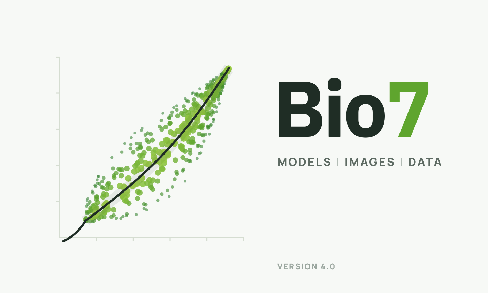

# Bio7 User Guide

**Bio7** is an integrated development environment for ecological modelling, scientific image analysis and statistical analysis. It is based on the Eclipse Rich Client Platform and embeds R and Python, ImageJ (SWTImageJ), a Java compiler, script languages (Groovy, BeanShell, JavaScript), a 3D view with a plot API and a virtual globe (WorldWind).

## 📖 Open the manual

- **[Bio7 Manual (HTML)](https://bio7.github.io/bio7documentation/Bio7_Manual.html)**: read it in the browser (sidebar, search, light and dark theme)
- **[Bio7 Manual (PDF)](Bio7_Manual.pdf)**: with a table of contents and bookmarks ([direct download](https://raw.githubusercontent.com/Bio7/bio7documentation/main/Bio7_Manual.pdf))
- [Classic HTML version](https://bio7.github.io/bio7documentation/Main.html)

The user guide of Bio7 4.0 (work in progress): the platform, the perspectives (ImageJ, R, Python, 3D, WorldWind, Web and custom perspectives), the editors, the preferences, the themes and more.

The HTML versions are published with GitHub Pages and updated with every change of this repository.

## 📄 Further documents

Guides and test reports of Bio7 4.0 (PDF):

| Document | Content |
|---|---|
| [Debugging R and Python in Bio7](documents/Bio7_R_and_Python_Debugger_Guide.pdf) | The R and the Python debugger: from a simple script to classes in several files (breakpoints, stepping, Run to Cursor) and a stress test of both debuggers |
| [Stress test of the Python and R bridges: Windows](documents/Bio7_Bridge_Stresstest_Windows.pdf) | The embedded Python and R under load: latency, data transfer, memory, callbacks, numerical precision |
| [Stress test of the Python and R bridges: Linux (WSL)](documents/Bio7_Bridge_Stresstest_Linux_WSL.pdf) | The same tests on Linux (Ubuntu in WSL 2) |
| [Stress test of the Python and R bridges: macOS](documents/Bio7_Bridge_Stresstest_macOS.pdf) | The same tests on macOS (Apple Silicon), with the comparison against standalone Python and R processes |
| [Bio7 4.0 API (HTML)](https://bio7.github.io/bio7documentation/api/index.html) | The Java API of Bio7 for scripts and models (Javadoc): Work, CustomView, the R and Python bridges, the 3D views and measurements, GDAL, ImageJ methods, WorldWind and the simulation API (models in Java, Python and R, exported as HTML pages) |
| [3D measurements compared with PyMeshLab, Open3D, VTK and CGAL](documents/Bio7_3D_Measurement_Library_Comparison.pdf) | The measurements of the 3D perspective against five mesh libraries and analytic values, with an introduction to voxels, surfaces and measurement errors |
| [Bio7, CGAL and VTK: a detailed comparison](documents/Bio7_3D_CGAL_VTK_Comparison.pdf) | Mesh validity, distance to the exact surface, Hausdorff distance, mesh quality, convex hull, inside test, smoothing and speed |

## Links

- Bio7 website: <https://bio7.org>
- Bio7 source code and downloads: <https://github.com/Bio7/bio7>

The manual is written in LyX, see [BUILD.md](BUILD.md) for the sources and the build.

© 2005-2026 M. Austenfeld
