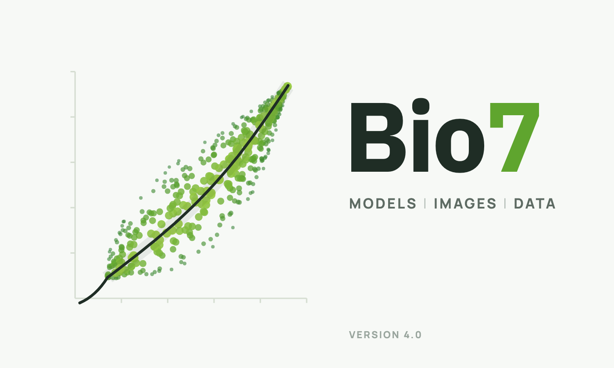

# Bio7 User Guide

**Bio7** is an integrated development environment for ecological modelling, scientific image analysis and statistical analysis. It is based on the Eclipse Rich Client Platform and embeds R, ImageJ (SWTImageJ), a Java compiler, script languages (Groovy, BeanShell, Jython, JavaScript), a 3D view with a plot API and a virtual globe (WorldWind).

## 📖 [Open the Manual (PDF)](Bio7_Manual.pdf)

The user guide of Bio7 4.0 (work in progress): the platform, the perspectives (ImageJ, R, 3D, WorldWind, Web and custom perspectives), the editors, the preferences, the themes and more – with a table of contents and bookmarks.

Further versions in this repository:

- **Bio7_Manual.html** – a modern HTML version (sidebar, search, light and dark theme)
- **Main.html** – the classic HTML version

## Links

- Bio7 website: <https://bio7.org>
- Bio7 source code: <https://github.com/Bio7/bio7>

The manual is written in LyX, see [BUILD.md](BUILD.md) for the sources and the build.

© 2005-2026 M. Austenfeld
